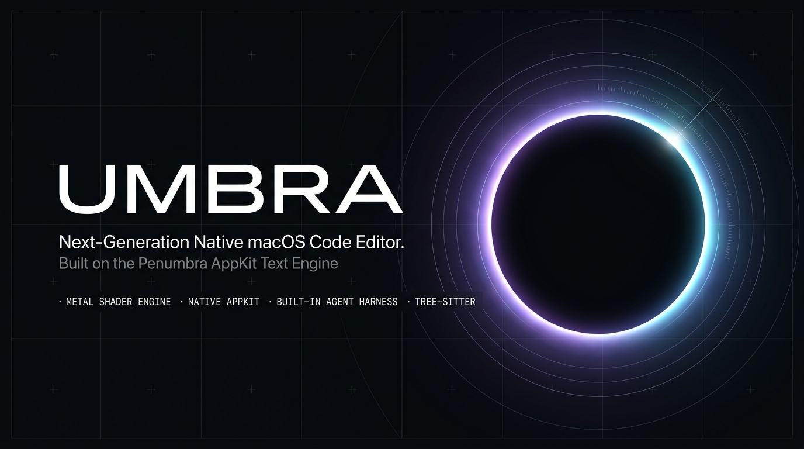
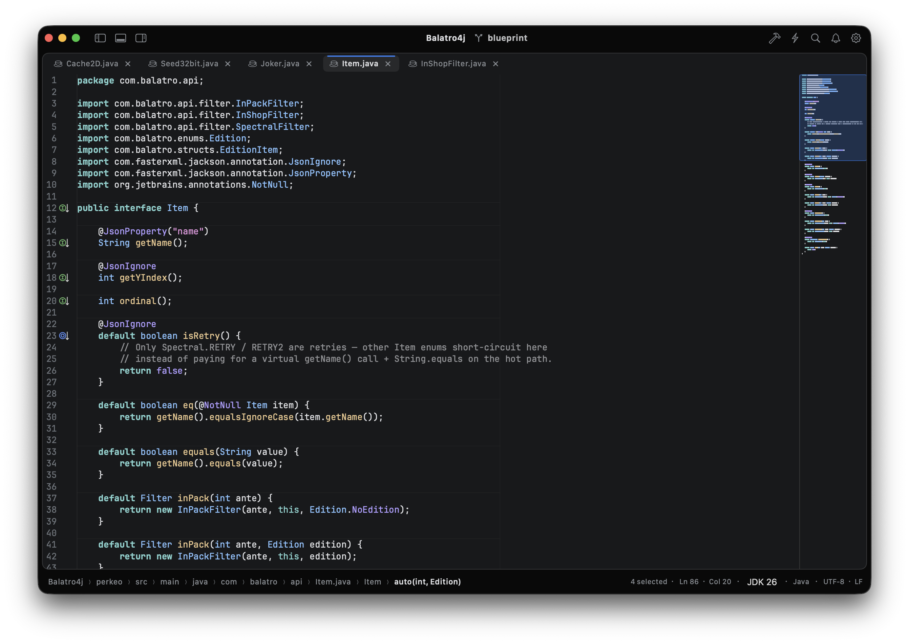
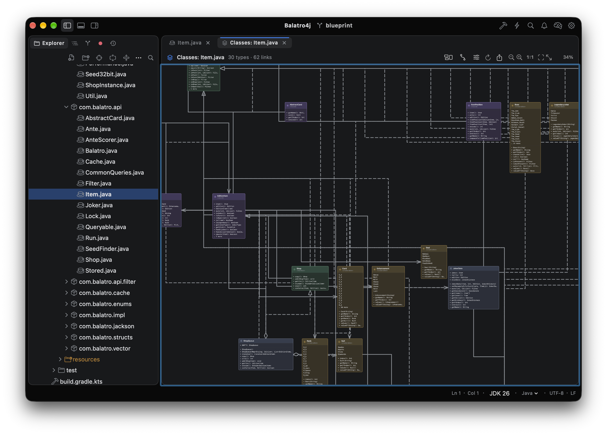
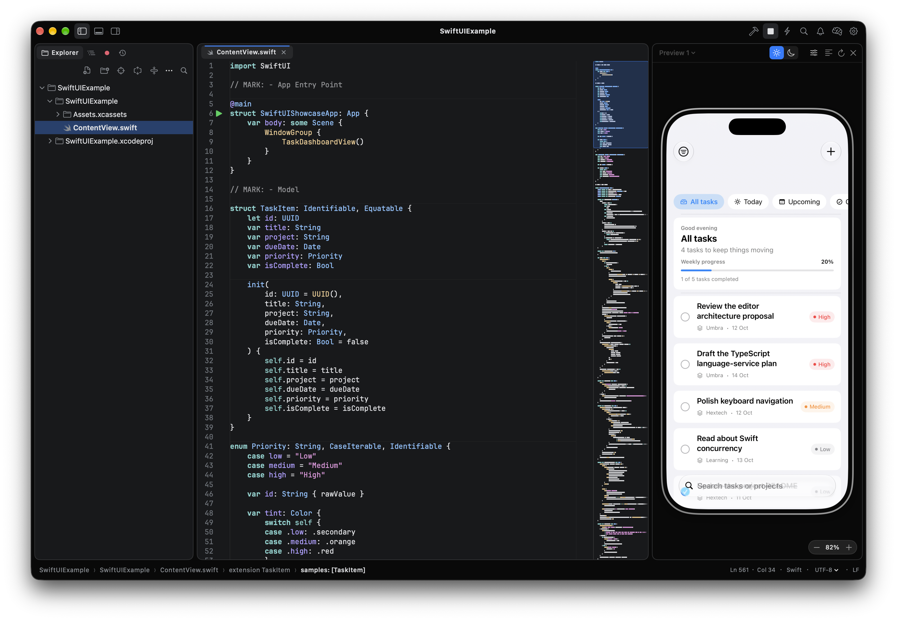

<p align="center">
  
</p>

# Umbra & Penumbra

**Umbra** is a fast macOS code editor with a built-in coding agent. **Penumbra** is the AppKit text engine and IDE-intelligence libraries underneath it. Use Umbra as your daily editor; embed Penumbra when you are building your own macOS editing surface.

[Download Umbra](https://github.com/alex-cova/Penumbra/releases) · [Website](https://alex-cova.github.io/Penumbra) · [Build from source](#build-from-source) · [Embed Penumbra](#installation)

> ### Meta Global AI Developer Hackathon
>
> Umbra is an entry in the [Meta Global AI Developer Hackathon](https://dev.meta.ai/events/global-hackathon), run by Meta in October–November 2026. Umbra's coding agent talks to Meta's Model API (`api.meta.ai`) and can run on the Muse models: choose **Meta (Muse)** as the provider in the model picker and add your API key (it is stored in the Keychain). See [Coding agent](#coding-agent).
>
> Meta and Muse are trademarks of Meta Platforms, Inc. Umbra is an independent project.

## Contents

1. [Umbra](#umbra) — [Highlights](#highlights) · [Coding agent](#coding-agent) · [Build from source](#build-from-source)
2. [Penumbra](#penumbra) — [Modules](#modules) · [Installation](#installation) · [Quick start](#quick-start) · [Keymaps](#keymaps)
3. [Repository](#repository) — [Layout](#layout) · [Development](#development) · [Community](#community) · [License](#license)

---

# Umbra

A **Sublime Text–style** editor that stays light, opens real project folders, and ships a **full coding-agent harness** beside your buffers, not a webview bolt-on.

| Java editing | Class diagram blueprint |
| :---: | :---: |
|  |  |

| SwiftUI live preview |
| :---: |
|  |

## Highlights

- **Fast editing first.** Metal rendering, mmap-backed large files, minimap, folding, multi-cursor and column selection, and a Sublime-style keymap out of the box.
- **Project-native.** Explorer, split panes, tabs, multiple windows (one project each), session restore, command palette, Problems panel, and a git workflow (stage, commit, diff tabs, change markers, local history).
- **Java and Gradle without a JVM IDE.** Sync, completion, inspections, run configurations, test gutter, JDI debugger, coverage and profiling, class and dependency diagrams. Maven, SwiftPM and npm projects are recognised too.
- **Intelligence.** Symbol-index completion, hover, go to definition, find usages, rename with preview, inlay hints and code vision. The libraries are LSP-ready; Umbra bundles native Java, TypeScript and Swift intelligence.
- **Built-in tools.** Integrated terminal, run and debug tool windows (Java via JDI, Swift and JS via DAP), hex editor, CSV table preview, Markdown and JSON diagram preview, an `.http` client with variables and cookies, and text tools (encode/decode, JSON format, JWT decode, hashes).
- **Tree-sitter highlighting** for Swift, Java, Kotlin, Go, Rust, JS/TS, Python, JSON, YAML, HTML, Markdown, SQL, HTTP and more.

## Coding agent

Dock the chat beside the editor or expand it full-width. The agent is [AgentKit](Packages/AgentKit/CLAUDE.md), wired to your real workspace, including unsaved buffers.

| | |
| --- | --- |
| **Explore** | `read_file`, `list_dir`, `glob`, `grep` (respecting git-visible files), `git_status` / `git_diff`, diagnostics |
| **Change code** | `edit_file` / `write_file` with diffs, applied to open tabs so undo works, and **Revert run** from checkpoints |
| **Execute** | Shell commands (with approval), Gradle and test tasks, optional web search |
| **Stay in control** | Plan / ask / auto permission modes, per-edit approval, rewind and fork, `@file` mentions, slash commands and project skills, context meter and `/compact` |

Project instructions load from `AGENTS.md` (or `CLAUDE.md`, `.cursorrules`) at the root and in nested folders; permission rules live in `.umbra/settings.json`.

**Models.** Bring your own:

- **Meta (Muse)** through the Meta Model API
- OpenAI-compatible APIs
- Ollama on localhost
- On-device models via MLX or Apple Intelligence

Keys stay in the Keychain, and nothing leaves the Mac without your consent.

## Build from source

```bash
./run.sh                     # debug (swift run --package-path Umbra Umbra)
./run.sh --no-metal          # Core Graphics renderer (Metal is the default)
./Scripts/build-app.sh       # release app bundle in dist/
```

Releases are `Umbra-<version>-macOS.zip` on [GitHub Releases](https://github.com/alex-cova/Penumbra/releases). Building Umbra needs macOS 26 and Xcode 26+ (Swift 6.2). Signing, notarization, Sparkle updates, shortcuts and day-to-day usage: [Umbra/README.md](Umbra/README.md).

---

# Penumbra

A high-performance plain-text and code **editor framework for macOS (AppKit)**. It extends the [Runestone](https://github.com/simonbs/Runestone) lineage (originally iOS/UIKit) with native macOS porting, **Metal** glyph rendering, **piece-tree** storage for large files, a multi-pane **workbench**, and the **Editor Intelligence Platform (EIP)**: completion, tree-sitter parsing, indexing, navigation, diagnostics, refactoring, and LSP/AI hooks.

Penumbra stays **App Store–safe**: public APIs only, sandbox-compatible patterns, and no `Process` in library targets. Host apps (like Umbra) spawn tools such as Gradle at the app layer.

## Modules

These are the products of the root `Package.swift`. It targets macOS 14 and pulls in none of the app's dependencies (Sparkle, SwiftTerm, the agent packages).

| Module | Role |
| --- | --- |
| **Penumbra** | `TextView` engine, gutter, themes, folding, minimap, workbench, EditorChrome views |
| **EditorIntelligence** | Editor-agnostic EIP: completion, hover, navigation, diagnostics, snippets, workspace. No dependency on `Penumbra` |
| **EditorIntelligenceLSP** | LSP client (ChimeHQ LanguageClient) |
| **PenumbraLanguages** + grammar targets | Tree-sitter factories for common languages; dedicated `PenumbraGraphQLLanguage` and `PenumbraMarkdownLanguage` |
| **JavaIntelligence** | Native Java index, completion, navigation, diagnostics, refactoring, Gradle model |
| **SwiftIntelligence** / **TypeScriptIntelligence** | Syntactic Swift and TypeScript engines |
| **HexKit** | Hex editor byte model |
| **GitIntelligence** / **SubprocessKit** | Git CLI wrapper and child-process spawning |

The engine and the EIP connect only through `PenumbraEditorAdapter` (the `EditorAdapter` protocol and an `AsyncStream<EditorEvent>`). Third-party attributions: [THIRD_PARTY_NOTICES.md](THIRD_PARTY_NOTICES.md).

### Engine features

- **AppKit-native.** `NSTextInputClient`, IME, smooth scrolling, configurable `Keymap` (`.default_`, `.sublime`, `.intelliJ`).
- **Metal rendering** via `TextView.isMetalRenderingEnabled` (on by default), with a Core Graphics fallback.
- **Large files.** mmap-backed `PieceTree` for buffers over 256 KB and `TextViewState.load`.
- **Multi-cursor and column selection.** Option-click carets, occurrence selection, block selection, semantic expand/shrink, synchronized typing and undo.
- **Tree-sitter highlighting.** Incremental and async, with language injection (for example CSS/JS in HTML). `TextViewState` parses off the main thread.
- **Display and editing.** Folding, minimap, focus mode, typewriter scrolling, line numbers, page guide, invisibles, character pairs, smart indent, line and statement moves, surround-with, timed undo coalescing.
- **Search and replace.** `SearchQuery`, regex captures, batch replace, find panel.
- **Diagnostics and navigation history.** Squiggles and bounded back/forward (⌘[ / ⌘]).

### Editor Intelligence Platform

- **Decoupled core.** `EditorAdapter`, a symbol `Trie` index, and a concurrent `CompletionEngine` with ranking.
- **Providers.** Symbols, words, snippets, LSP and AI, with ghost text and multi-cursor apply.
- **Navigation.** Hover, definition, references, implementations, rename, outline, breadcrumbs.
- **Diagnostics and refactoring.** Built-in analyzers plus LSP aggregation.
- **Workspace.** Multi-document actor, cross-file search, file watching.
- **LSP.** Document sync, completion, hover, definition, references, rename, formatting, code actions, signature help, semantic tokens.
- **Workbench and chrome.** Split layouts, tab groups (preview/pinned), session restoration, a command palette, and AppKit views for completion, hover, ghost text, parameter hints, breadcrumbs, outline, code actions and workspace search.

## Installation

Add Penumbra to your `Package.swift`:

```swift
dependencies: [
    .package(url: "https://github.com/alex-cova/Penumbra.git", branch: "main")
]
```

```swift
.target(
    name: "YourAppTarget",
    dependencies: [
        .product(name: "Penumbra", package: "Penumbra"),
        .product(name: "EditorIntelligence", package: "Penumbra"),
        .product(name: "EditorIntelligenceLSP", package: "Penumbra"),       // optional
        .product(name: "PenumbraLanguages", package: "Penumbra"),             // optional
        .product(name: "PenumbraGraphQLLanguage", package: "Penumbra"),      // optional
        .product(name: "PenumbraMarkdownLanguage", package: "Penumbra")     // optional
    ]
)
```

**Requirements:** macOS 14+, Swift 6.0+ (Swift 6 language mode). Dependencies are vendored [Tree-sitter](https://github.com/tree-sitter/tree-sitter), [ChimeHQ/LanguageClient](https://github.com/ChimeHQ/LanguageClient) and related ChimeHQ packages.

## Quick start

### Basic `TextView`

```swift
import AppKit
import Penumbra

class EditorViewController: NSViewController {
    private var textView: TextView!

    override func loadView() {
        textView = TextView(frame: CGRect(x: 0, y: 0, width: 800, height: 600))
        textView.theme = DefaultTheme()
        textView.showLineNumbers = true
        textView.isLineWrappingEnabled = true
        textView.showMinimap = true
        textView.isLineFoldingEnabled = true
        textView.isMetalRenderingEnabled = true
        textView.text = """
        // Welcome to Penumbra on macOS!
        func greet(name: String) {
            print("Hello, \(name)!")
        }
        """
        self.view = textView
    }
}
```

### Async state with Tree-sitter

```swift
import Penumbra
import PenumbraLanguages

let jsLanguage = TreeSitterLanguage.javaScript

DispatchQueue.global(qos: .userInitiated).async {
    let state = TextViewState(
        text: largeJavaScriptCodeString,
        theme: DefaultTheme(),
        language: jsLanguage
    )
    DispatchQueue.main.async { textView.setState(state) }
}

// Or load from disk (mmap piece tree):
let state = try await TextViewState.load(
    contentsOf: fileURL,
    theme: DefaultTheme(),
    language: TreeSitterLanguage.swift
)
textView.setState(state)
```

### Multi-cursor

```swift
textView.selectNextOccurrence()      // ⌘⇧D
textView.selectAllOccurrences()      // ⌘⇧L
textView.addCaretAbove()             // ⌥⌘↑
textView.duplicateSelectedLines()    // ⌘D
```

### Editor intelligence controller

```swift
import Penumbra
import EditorIntelligence

let symbolIndex = SymbolIndex()
let intelligenceController = EditorIntelligenceController(
    textView: textView,
    completionEngine: CompletionEngine(providers: [
        SymbolCompletionProvider(index: symbolIndex),
        WordCompletionProvider(),
        SnippetCompletionProvider(snippets: mySnippets)
    ]),
    hoverEngine: HoverEngine(providers: [SymbolHoverProvider(index: symbolIndex)]),
    diagnosticEngine: DiagnosticEngine(providers: [DuplicateSymbolDiagnosticProvider()]),
    services: EditorIntelligenceServices(symbolIndex: symbolIndex)
)
```

### Workbench

```swift
let workbench = EditorWorkbench()
workbench.openDocument(WorkbenchDocument(displayName: "main.swift", text: "print(\"Hello\")"))
let rightPane = workbench.splitActivePane(edge: .trailing)
let state = workbench.makeRestorationState()
```

## Keymaps

Three presets ship: `.default_`, `.sublime` (Umbra's default) and `.intelliJ`. Bindings map to `EditorActionID` and `textView.perform(_:)`. Palette and LSP actions need a `CommandPaletteController` and an `EditorIntelligenceController` attached to the text view.

| Shortcut | Action |
| :--- | :--- |
| **⌥ + Click** | Add caret |
| **⌘⇧D** / **⌘⇧L** | Next occurrence / all occurrences |
| **⌥ + Drag** / **⌃⇧ arrows** | Column selection |
| **⌘L** / **⌘D** / **⌘⌫** | Select / duplicate / delete line(s) |
| **⌘F** | Find / replace panel |
| **⌃Space** | Completion (with intelligence controller) |
| **⌘ + Click** | Go to definition |
| **⌘[ / ⌘]** | Navigation history |

**`.intelliJ` differences from `.default_`:**

| Shortcut | Action |
| :--- | :--- |
| **⇧⇧** / **⌘⇧A** | Search Everywhere / Find Action |
| **⌘E** | Recent files |
| **⌥↑ / ⌥↓** | Extend / shrink selection by syntax node |
| **⌘⇧↑ / ⌘⇧↓** | Move statement up / down |
| **⌘⇧8** | Toggle column selection mode |
| **⌥⌘T** | Surround with… |
| **⌥⌘L** | Reformat code (LSP or fallback) |
| **⌘B** / **⌥⌘B** | Go to definition / implementation |

---

# Repository

## Layout

The repo holds two Swift packages, plus the agent packages and tools they share.

```
Penumbra/
├── Package.swift                  # The libraries (macOS 14): Penumbra, EditorIntelligence, language packs, …
├── Sources/                       # Library sources, one folder per module
├── Tests/PenumbraTests/           # Library tests
├── Umbra/                         # The app: its own package (macOS 26) that depends on the root package
│   ├── Package.swift
│   ├── Sources/Umbra/             # The editor
│   ├── Sources/UmbraACP/          # Umbra as an ACP agent on stdio
│   ├── Tests/UmbraTests/          # App tests
│   └── Umbra.xcodeproj            # For SwiftUI Previews and run/debug
├── Packages/                      # AgentKit(+MLX, Apple), DatabaseKit, GitIntelligence, SubprocessKit, TreeSitter, Luna
├── Tools/PerfHarness/             # Release performance CLI
└── Tools/AgentEval/               # Agent evaluator (its own package)
```

Deeper internals: [CLAUDE.md](CLAUDE.md), [Umbra/CLAUDE.md](Umbra/CLAUDE.md), [Sources/Penumbra/CLAUDE.md](Sources/Penumbra/CLAUDE.md), [Sources/EditorIntelligence/CLAUDE.md](Sources/EditorIntelligence/CLAUDE.md).

## Development

```bash
swift build                              # libraries (repository root)
swift test                               # library tests; needs a live display, see CLAUDE.md
swift test --package-path Umbra          # Umbra's tests
swift run -c release PerfHarness enter-session synthetic --lines 20000
```

Performance rules: [docs/PERFORMANCE_RULES.md](docs/PERFORMANCE_RULES.md). SwiftLint: `.swiftlint.yml`. The suites hold 6,800+ tests across line management, multi-cursor editing, tree-sitter, Metal, completion, workbench, LSP bridges, the agent, and the app itself.

## Community

- [Contributing](CONTRIBUTING.md): setup, tests, the rules that protect the libraries, and how to open a pull request
- [Support](SUPPORT.md): where to ask, and what a useful bug report contains
- [Code of Conduct](CODE_OF_CONDUCT.md): Contributor Covenant 2.1
- [Security policy](SECURITY.md): report vulnerabilities privately through GitHub, not in a public issue

## License

Apache License 2.0. See [LICENSE](LICENSE). Contributions are accepted under the same license (Apache-2.0 section 5); there is no CLA.
