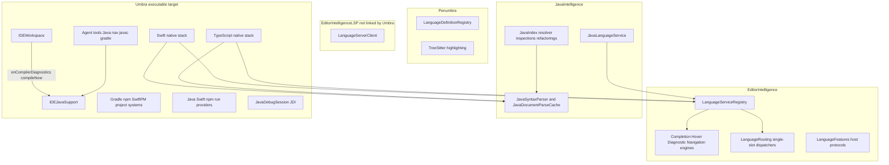
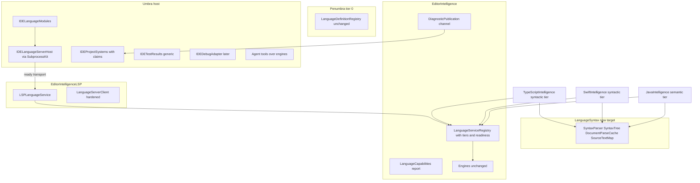
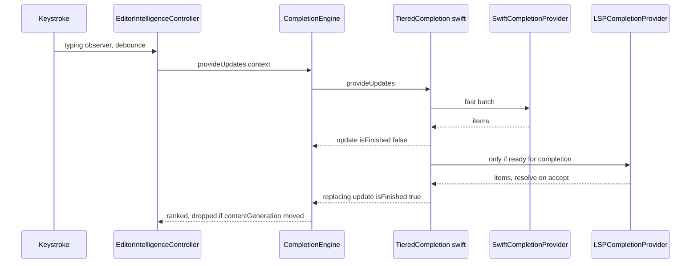

Status, as of Oct 10, 2026. Finished items match the plan todos. Continue from `docs/LANGUAGE_PARITY_HANDOFF.md`.

**Done**
- This plan is `docs/LANGUAGE_PARITY_PLAN.md`, linked from `docs/LANGUAGE_SUPPORT_PLAN.md` and `docs/ADDING_A_LANGUAGE.md`. The stale `SwiftSourceNormalizer` note was already gone; the Swift and TypeScript docs point at the library targets.
- `SwiftIntelligence` and `TypeScriptIntelligence` are library targets. Umbra keeps the window wiring. Existing Swift and TypeScript tests passed after the move.
- `LanguageSyntax` holds the shared parser (`SyntaxTree`, `SyntaxParser`, `SyntaxNode`, `DocumentParseCache`, `ParseEdit`). Java's public names are aliases. It depends on EditorIntelligence as well as TreeSitter, because edits use `Document` and `TextEdit`. The concrete tree is `LanguageSyntax.SyntaxTree` because EditorIntelligence already has a `SyntaxTree` protocol. `SourceTextMap` and `SourceLocations` live in EditorIntelligence.
- Document parses go through `DocumentParseCache`, which reapplies a one-diff incremental parse. String-only Swift parses (outline, colours) still use the small memo, because those calls have no file URL.
- PerfHarness modes `swift-index`, `swift-completion`, `ts-index`, and `ts-completion` exist. Release numbers are in `docs/EDITOR_PERF_PLAN.md`.
- Registry tiers and one `Tiered*Provider` per language. Completion yields the syntactic batch, then replaces it with the semantic batch under one provider name. Hover and navigation ask the top ready tier and fall back on nil. Diagnostics keep every ready tier; `DiagnosticEngine` dedupes. Single-slot routing skips a service whose `unavailableFeatures` contains the feature.
- LSP capability gating, `completionItem/resolve`, call and type hierarchy requests, and a scripted fake server over pipes (`LSPFakeServerTests`). No Xcode and no Node in that test.
- `IDELanguageServerHost` launches through SubprocessKit with stdout capture `.discard` (a 100 MB `dd` leaves an empty buffer). Per-folder trust, a status-bar summary, restart with backoff, and `IDELanguageModule.languageServers`. A crash clears the connection and starts the process again. The workspace deallocates while a server is running.
- SourceKit-LSP and typescript-language-server are declared and registered beside the native services. They stay unavailable until the folder is trusted and the host installs a client. The native TypeScript service also claims `javascript` and indexes `.js`, `.jsx`, `.mjs`, and `.cjs`. Generate can write Equatable and Hashable.
- `LanguageServiceConformance` checks a foreign language, that the capability report does not name an unavailable feature, that a cancelled request returns promptly and is not delivered, that `stop()` drops the environment, and that request work stays off the main actor. The three hooks (`projectDidChange`, `filesDidChange`, `documentsDidSave`) are the calls that run on it.
- Swift organize imports sorts, drops duplicate lines, and groups `@testable` imports (`SwiftImportOrganizer`). It does not remove an import the file never spells: that needs the compiler. SourceKit-LSP does not provide this action.
- `.tsx` and `.jsx` highlight with `tree_sitter_tsx()`. The language identifier stays `typescript` or `javascript`, so the mapping tests are unchanged. Parsing already used that grammar.
- `enter-session` at 20k and 120k lines was re-measured against `20fad79`. Enter stays ~0.9 ms at the top and ~11.7 ms in the middle. Numbers are in `docs/EDITOR_PERF_PLAN.md`. One run is not a gate.
- `SourceFileIndex<Model>` owns enumeration, the 1 MB cap, the fan-out of 8, generation, pending edits, and the open-buffer lookup. `SwiftIndex` and `TypeScriptIndex` keep their public methods and their own lookup tables.

**Still open**
- Phase 9 stops after the lldb-dap spike below. Launch never reached a stop, so `IDEDebugSession` was not added. Phase 10 stays gated.
- The full suite (`caffeinate -u -d -i -s swift test`) has not been run for this work.

## lldb-dap spike (phase 9, Oct 10 2026)

Adapter: `/Applications/Xcode.app/Contents/Developer/usr/bin/lldb-dap` (LLVM 21.0.0, liblldb 2103.0.34.103, Apple Swift 6.4). Discovery is `UMBRA_LLDB_DAP_PATH`, then `xcrun --find lldb-dap`. The probe is `LLDBDAPSpike` in the Umbra target, launched through SubprocessKit, gated by `UMBRA_LLDB_DAP=1` (`LLDBDAPSpikeTests`). It is skipped when the binary is absent.

What succeeded: `swiftc -g -Onone` of a three-line program; Content-Length `initialize` and its response; `lldb` `target create` and `breakpoint set --file main.swift --line 2` (the breakpoint binds at `main + 24`). This adapter does not send an `initialized` event after `initialize`.

What failed: `launch`, even with `setBreakpoints` and `configurationDone` already written to the pipe, produces no further DAP message. `lldb -b` stops at `run` the same way: debugserver starts and the private-state thread waits forever. Running the binary directly exits. A pseudo-terminal does not unblock it. The agent shell's sandbox sentinel is `.sb-56ca21c4`. Stop, variables, step, and evaluate were not reached.

`IDEDebugSession` and a `JavaDebugSession` wrapper are not added until a Swift session stops on a breakpoint.

Decisions recorded in the source plan: TypeScript's semantic tier is LSP (typescript-language-server or vtsls driving the project's tsserver), and direct distribution comes first (external servers are first-class; the App Sandbox spike is phase 10).

# Umbra: Language-Agnostic Architecture and Swift/TypeScript Parity Plan

The status block above is the implementation record. The rest of this document is the original plan. Every claim marked **(verified)** was checked in code on Oct 10, 2026 (`main`, 3 commits ahead of origin); **(inferred)** marks conclusions drawn from it. Decisions taken with the user: TypeScript gets its semantic tier through **LSP** (typescript-language-server or vtsls driving the project's own tsserver), and **direct distribution comes first**: external servers are first-class, and a sandbox spike is a gated later phase.

---

## 1. Executive summary

Phases 0 to 5 of [docs/LANGUAGE_SUPPORT_PLAN.md](docs/LANGUAGE_SUPPORT_PLAN.md) already built most of the framework the brief asks for. `LanguageDefinition`, `LanguageService` and `LanguageServiceRegistry`, `LanguageEnvironment`, `IDELanguageModule`, `IDEProjectSystem` and `IDERunProvider` all exist and are tested. Swift and TypeScript already use these seams. **The gap is not the framework. It is semantic depth, plus a few Java-only seams that the framework never reached.**

The problems found, each traceable to code:

- **P1. The shared syntax layer lives in `JavaIntelligence`.** Swift and TypeScript parse through `JavaSyntaxParser`, `JavaSyntaxTree`, `SyntaxNode`, `JavaDocumentParseCache` and `SourceTextMap` (`Sources/JavaIntelligence/Syntax/`). That is 16 Swift/TS files that import Java's types just to parse. **(verified)**
- **P2. Swift and TypeScript reparse whole files.** `SwiftAnalysis` calls `JavaSyntaxParser.parse` with no old tree; `SwiftParseMemo` keeps only the last 2 sources. TypeScript calls `JavaDocumentParseCache.tree(for:)` without edits. Java uses `parseIncremental`. **(verified)**
- **P3. The Swift and TypeScript engines are parallel copies inside the app target.** Each has a support class, an index actor (generation, `pendingEdits`, open-buffer overlay), a paths type (skip directories, 1 MB cap), export refs and palette symbols, all in `Example/Umbra/{Swift,TypeScript}`. Because they live in an executable target, `PerfHarness` cannot link them, so there are **no Swift or TypeScript benchmarks**. **(verified)**
- **P4. Their semantics are syntactic, which caps accuracy.**
  - Swift: no generic inference, overloads chosen by labels only, and a hand-written standard library table of about 73 members (`SwiftStandardLibrary.swift`). No SDK.
  - TypeScript: types come only from an annotation, `new` or `as`. No return-type inference, narrowing, `node_modules`, `.d.ts`, tsconfig `paths`, JSX/TSX grammar, or JavaScript intelligence (the service claims only `typescript`). **(verified)**
- **P5. The LSP layer is incomplete and unlinked.** Umbra does not depend on `EditorIntelligenceLSP`. `requestDiagnostics` returns `[]` and nothing receives `publishDiagnostics`. Rename reads only `edit.changes`. There is no capability negotiation, no `completionItem/resolve`, `documentSymbol`, `workspace/symbol`, hierarchy or inlay request, and no server launcher (about 1,457 lines in total). **(verified)**
- **P6. Two services cannot be layered for one language.** The registry merges engine arrays from every service and gives stateful features to the "first owner". `HoverEngine` runs providers concurrently and takes the first non-nil answer. If a SourceKit-LSP service were registered beside the native Swift one, both would claim `isPrimary`, completions would duplicate, hover would race, and a server that is still starting would win rename. **(verified rules; the outcome is inferred)**
- **P7. Pushed diagnostics, test results and agent tools are Java-shaped.**
  - Diagnostics: `IDEWorkspace` wires `javaSupport.onCompilerDiagnostics`, `onInspectionDiagnostics` and `compileNow(openJavaDocuments())` on save, and `IDEProblemsStore` has `javac`- and `java-inspection`-specific buckets.
  - Test results: `IDETestResultsStore.cases` is `[JavaTestCaseResult]`, and Swift gets around that with `rerunHandler`.
  - Agent: `go_to_definition` and `find_usages` go through `IDEAgentJavaNavigating`; `diagnostics` compiles fresh only with javac; `run_tests` is Gradle-only. **(verified)**
- **P8. Capabilities are implicit.** "Nil provider" is the only signal. There is no declared fidelity (syntactic, semantic or compiler-grade), so parity cannot be measured and the UI cannot say "Swift: SourceKit-LSP starting".
- **P9. Project-system precedence is registration order.** The window registers `[gradle, npm, swiftPM]` and the first match is `active`. npm reads only the root `package.json`, with no workspaces, lockfile-based package-manager detection or tsconfig. **(verified)**
- **P10. Debugging is Java-only (JDI JSON adapter), with no adapter abstraction.** This is correct under the plan's rule "add a contribution point when a second language needs it", and lldb-dap would be that second language.

**Recommended direction:**
1. Keep Java's engine untouched.
2. Keep the native Swift and TypeScript engines as the always-available **syntactic tier**.
3. Add a **semantic tier** per language through one hardened `LSPLanguageService`, with servers launched by Umbra through SubprocessKit.
4. Teach the registry about **tiers and readiness**, so the semantic tier answers when it is ready and the native tier covers start-up, crashes and features the server lacks.
5. Extract the syntax layer into a neutral target, move Swift and TypeScript into library targets, and generalize the four Java-only seams in P7.

Hardening the LSP layer also makes every bundled grammar that has a mature server (Go, Rust, C, C++, Kotlin) close to a one-file language. That is the main source of leverage in this plan.

---

## 2. Current-state architecture



**Lifecycle as built (verified):**
1. **Identify.** `LanguageDefinitionRegistry` maps an extension to an identifier (`.tsx` maps to `typescript`, `.jsx` to `javascript`).
2. **Highlight.** Penumbra highlights with the bundled grammar.
3. **Window start.** `IDEIntelligenceServices.init` builds one registry per window: Java, TypeScript, Swift, `umbra.run`, Markdown mentions, HTTP, JSON.
4. **Engines.** The engines get the generic providers plus `registry.*Providers`, with skips taken from the policies.
5. **Start.** `bootstrap()` calls `languages.start(environment:)`.
6. **Open a folder.** `applyProjectRoot` calls `projectSystems.projectDidChange`, then `languages.projectDidChange`, both synchronously. Java reads Gradle's model through `IDEGradleModelConsumer`; Swift gets a `moduleResolver` from SwiftPM.
7. **Requests.** Typing schedules requests through `EditorIntelligenceController` (debounced, stale results dropped by `TextView.contentGeneration`). The host drives semantic tokens, line markers, structure and hierarchies through `registry.semanticTokens(for:)` and the other host lookups.
8. **Push diagnostics.** These are wired by hand for Java; SwiftPM build output goes to `setBuildDiagnostics(_:source: "swiftpm")`.
9. **Run and test.** A run uses `IDERunProvider`; tests go through Java's or Swift's provider into the Java-typed `IDETestResultsStore`.
10. **Teardown.** `teardown()` stops the registry in reverse order, then the project systems.

**Coupling that remains (verified counts):**
- In `IDEWorkspace*.swift`: 25 `javaSupport` references, 12 `"java"` literals, 164 `Java` and 62 `gradle`.
- 68 Umbra files import `JavaIntelligence`. Many of them only do so for the parser (P1).
- `IDEWorkspace.swift` is 6,037 lines; `IDEJavaSupport.swift` is 858.
- Preferences have about 20 `com.umbra.editor.java*` keys, including inlay and code-vision preferences that are generic in the engine, and no Swift, TypeScript or npm keys.

**Size of the engines (verified):**
- JavaIntelligence: 195 files, about 38k lines, 27 actors, 134 inspection rules, a 220-case completion corpus with a ratchet, and 4 PerfHarness modes.
- Swift: 24 files, 5,237 lines.
- TypeScript: 12 files, 2,600 lines.

**Stale documentation found:** `Example/Umbra/CLAUDE.md` describes a `SwiftSourceNormalizer` that no longer exists; grammar patches replaced it (`Sources/TreeSitterSwift/VERSION`).

---

## 3. Capability matrix (Java as the benchmark)

Each entry gives Java, Swift and TypeScript today, then **Owner** (shared infrastructure or language), the **Change**, and **Done when**. S, M and L are relative sizes (days, about a week, several weeks), not estimated line by line.

- **Syntax, folding, structure**
  - Java: tree-sitter with incremental parse, structure and breadcrumbs.
  - Swift: tree-sitter-swift 0.7.4 (patched), full reparse, native structure and breadcrumbs.
  - TS: TypeScript grammar only (`.tsx` parsed as TS, no JSX), full reparse, structure.
  - Owner: shared syntax target plus per-language walkers.
  - Change: phase 1 incremental parse; vendor the tsx grammar.
  - Done when: Swift and TS parse through `DocumentParseCache` with edits, and the release reparse cost after a 1-character edit in a 5k-line file is at or below the phase 0 baseline.
- **Semantic model, types, overloads, generics, inheritance**
  - Java: native (`JavaExpressionTyper`, `JavaMemberLookup`, `JavaAssignability`, JDK and JAR stubs).
  - Swift: syntactic `SwiftResolver`, labels only, no generics or SDK.
  - TS: annotation, `new` or `as` only.
  - Owner: language. Swift and TS get it from their compilers through LSP; Java keeps its own.
  - Done when: the Swift and TS completion and navigation corpora reach their phase 5 and 6 targets.
- **Completion, auto-import, snippets, postfix**
  - Java: full, with expected type, auto-import and postfix.
  - Swift: native members (with extensions), implicit `.case`, auto-`import`, Swift snippets.
  - TS: locals, project exports with relative auto-import; JavaScript-flavored generic snippets still on (the policy does not disable them).
  - Owner: shared tiered routing plus language.
  - Change: the native batch shows first, then the LSP batch replaces it; LSP `completionItem/resolve` supplies auto-import edits. Postfix templates stay native and per language, and are optional.
  - Done when: the corpus pass rate meets its target, and auto-import from a package or module the file does not import yet passes a golden test.
- **Signature help and hover**
  - Java: native with Javadoc and attached sources.
  - Swift: native, from `///` comments.
  - TS: hover only (JSDoc); no signature help.
  - Owner: language (LSP).
  - Done when: hover shows SDK and `.d.ts` documentation for corpus cases, and TS signature help works for overloaded calls.
- **Definition, implementation, type definition, usages, super method**
  - Java: all, including JARs and the decompiler.
  - Swift: all five natively (project only).
  - TS: definition and references only.
  - Owner: language (LSP, with native fallback). Super method stays native because LSP has no request for it.
  - Done when: the navigation corpus passes, including definitions into the SDK and `node_modules`.
- **Rename and refactoring previews**
  - Java: rename and 11 refactorings, through `RenamePlan` and `WorkspaceEditPlan` with a preview.
  - Swift: rename of resolved uses.
  - TS: local, exported and importing-file rename.
  - Owner: the shared preview pipeline (exists); language through LSP rename and refactor code actions (with `documentChanges`).
  - Done when: rename across modules and packages matches the golden plans; extract-function code actions apply through the preview.
- **Diagnostics, inspections, quick fixes**
  - Java: javac (push), 134 inspections, quick fixes.
  - Swift: syntax warnings while typing; `swift build` output into the `swiftpm` bucket.
  - TS: syntax errors only.
  - Owner: a shared `DiagnosticPublishing` channel (new); language sources.
  - Done when: for each fixture, the Problems panel and `swift build` or `tsc --noEmit` report the same (file, line, severity) set (gated comparison test).
- **Formatting and import organization**
  - Java: native formatter and organizer.
  - Swift and TS: none.
  - Owner: language. Swift: `swift format` through SourceKit-LSP formatting. TS: tsserver formatting through LSP, with Prettier as an optional project tool later. Organize imports: TS through the `source.organizeImports` code action; Swift natively, because SourceKit-LSP lacks it.
  - Done when: Reformat Code and Optimize Imports produce the golden output for the fixtures.
- **Inlay hints, semantic tokens, breadcrumbs, code vision, line markers**
  - Java: all.
  - Swift: semantic tokens, breadcrumbs and line markers natively.
  - TS: semantic tokens and breadcrumbs.
  - Owner: shared host scheduling (exists). Inlay hints and semantic tokens come from LSP (legend mapped to `SemanticHighlight`); line markers stay native; code vision is optional.
  - Done when: the inlay preferences are per language and LSP tokens paint through the existing scheduler without a regression in `enter-session`.
- **Type and call hierarchy**
  - Java: both. Swift: both natively. TS: none.
  - Owner: language. Add LSP `prepareCallHierarchy` and `typeHierarchy` to the client.
  - Done when: TS call hierarchy works through the existing panels.
- **Code generation**
  - Java: constructor, accessors, `toString()`.
  - Swift: memberwise `init`, `description`, `CodingKeys`.
  - TS: none.
  - Owner: language. Swift natively adds Equatable and Hashable; TS uses LSP refactor actions where they exist.
  - Done when: each Generate entry has a golden test.
- **Project model, SDK, dependencies, source roots**
  - Java: Gradle model (format 5), JDK selection, JAR shards.
  - Swift: SwiftPM manifest and `dump-package`, module resolver; no toolchain selection.
  - TS: root `package.json` scripts only.
  - Owner: project systems (shared protocol exists) plus toolchain discovery per language in Umbra.
  - Done when: npm workspaces and nested packages are detected, the package manager is chosen from the lockfile, and the Swift toolchain is selectable.
- **Build, run, test discovery and execution, debugging**
  - Java: all, with a JDI debugger.
  - Swift: build, run and test through `--filter` with xunit; gutter tests; no debugger.
  - TS: `npm run` only; no tests or debugger.
  - Owner: a shared test-results model (new) and a debug adapter abstraction (later); language runners.
  - Done when: vitest and jest results reach Test Results, and lldb-dap passes the gated debugger spike.
- **Diagrams and agent integration**
  - Java: class and Gradle diagrams, agent navigation, javac and Gradle tools.
  - Swift and TS: one-file class diagrams, SwiftPM and npm graphs; no agent navigation.
  - Owner: shared. Agent navigation goes over `NavigationEngine`, and `run_tests` and `diagnostics` over the new generic seams.
  - Done when: `go_to_definition` works on a `.swift` and a `.ts` file in an agent test.
- **Performance, memory, cancellation**
  - Java: bounded caches, generations, 4 harness modes.
  - Swift and TS: in-memory only, 1 MB file cap, fan-out of 8; no harness.
  - Owner: shared harness and conformance tests.
  - Done when: section 10's benchmarks have baselines and gate every phase.

---

## 4. Target architecture



**Dependency rules (enforced by `Package.swift`):**
- `LanguageSyntax` depends only on `TreeSitter`.
- `EditorIntelligence` keeps zero dependencies.
- `*Intelligence` targets depend on `EditorIntelligence`, `LanguageSyntax` and their grammar, and never on `Penumbra` or `SubprocessKit`.
- `EditorIntelligenceLSP` depends on `EditorIntelligence` and ChimeHQ, takes a ready transport, and never spawns processes.
- Only Umbra spawns processes (SubprocessKit), discovers toolchains and asks for consent.
- `IDEWorkspace` never names a language. Java stays reachable only through its module, its service and its project system.

**Request flow with tiers (completion):**



**Server lifecycle:** a module declares an `IDELanguageServerDefinition`. When the folder opens and the user has trusted it, the host discovers the binary and launches it through SubprocessKit, then sends `initialize` with workspace folders and UTF-16 position encoding. It hands the connection to the `LSPLanguageService`, whose readiness flips to ready. If the server crashes, readiness goes false and the native tier answers while the host restarts it with backoff. `teardown()` sends `shutdown` and `exit`, then terminates the process group.

---

## 5. Protocol and API proposals (illustrative)

All are additive and have defaults, so existing conformances compile unchanged.

**Tiers, readiness and capabilities** (`Sources/EditorIntelligence/Languages/`):

```swift
public enum LanguageServiceTier: Int, Comparable, Sendable { case syntactic = 1, semantic = 2 }
public enum LanguageFeature: String, CaseIterable, Sendable {
    case completion, hover, signatureHelp, definition, implementation, typeDefinition, references,
         superMethod, rename, refactoring, codeActions, formatting, diagnostics, semanticTokens,
         inlayHints, codeVision, structure, breadcrumbs, lineMarkers, typeHierarchy, callHierarchy, codeGeneration
}
public enum FeatureFidelity: Int, Comparable, Sendable { case syntactic, semantic, compiler }

public extension LanguageService {
    var tier: LanguageServiceTier { .syntactic }                  // Java declares .semantic
    func fidelity(of feature: LanguageFeature) -> FeatureFidelity? { nil }  // nil = derived from providers
    /// Nonisolated and lock-backed: read on every request, so it must not await.
    func isReady(for feature: LanguageFeature) -> Bool { true }
    @MainActor func documentsDidSave(_ urls: [URL]) {}           // replaces Java's hand-wired compileNow
}

public struct LanguageCapabilityReport: Sendable, Equatable {
    public var features: [LanguageFeature: (service: String, fidelity: FeatureFidelity)]
}
// LanguageServiceRegistry.capabilities(for identifier:) -> LanguageCapabilityReport
```

- **Registry rule.** For each language identifier, services are ordered by `tier`, highest first, then by registration order. For every feature, the router picks the first service that has the provider **and** `isReady(for:)`.
  - **Engine features** (completion, hover, navigation, diagnostics): the registry hands the engine one `Tiered*Provider` per language group instead of the raw providers.
  - **Completion** yields the lower tier's batch first and replaces it with the higher one. This needs a verified "replace" semantic on `CompletionUpdate`; add `replacesPrevious` if the engine appends today.
  - **Hover and navigation** ask the top ready tier and fall back on nil. This removes the hover race.
  - **Diagnostics** keep both tiers (syntactic warnings plus semantic errors), deduplicated by the engine's existing key.
- **Why not have each LSP service embed its native fallback?** (Alternative B.) It is simpler for one language, but every pair has to reimplement fallback, readiness and dedup, and Java (no LSP) could not take part. Tiers keep the services independent, and a dictionary lookup per request respects the performance rules.

**Pushed diagnostics** (extends `LanguageEnvironment`, phase 3's pattern):

```swift
public struct DiagnosticSourceID: RawRepresentable, Hashable, Sendable { public let rawValue: String }
// .javac, .javaInspection, .gradle, .swiftPM, .sourceKitLSP, .typeScriptLSP
public struct DiagnosticPublication: Sendable {
    public var source: DiagnosticSourceID; public var url: URL; public var documentVersion: Int?
    public var diagnostics: [Diagnostic]                 // empty clears that source for the file
}
public extension LanguageEnvironment {
    var publishDiagnostics: @Sendable (DiagnosticPublication) -> Void   // stored closure, default drops
}
```

- `IDEProblemsStore` becomes `bySource[DiagnosticSourceID][URL]`. The existing `javac` precedence rule (an editor report rewrites the file's javac entry) is kept as a per-source policy.
- Java's `onCompilerDiagnostics`, `onInspectionDiagnostics` and `compileNow` on save move behind `publishDiagnostics` and `documentsDidSave`. That removes about 8 `javaSupport` references from `IDEWorkspace`.

**LSP service** (`Sources/EditorIntelligenceLSP/`):

```swift
public struct LSPLanguageConfiguration: Sendable {
    public var name: String
    public var languageIdentifiers: Set<String>                 // ["typescript", "javascript"]
    public var lspLanguageID: @Sendable (URL?, String) -> String  // "typescriptreact" for .tsx
    public var policy: LanguagePolicy
    public var enabledFeatures: Set<LanguageFeature>            // intersected with ServerCapabilities
    public var diagnosticSource: DiagnosticSourceID
}
public protocol LSPConnectionProviding: Sendable {
    var current: LSPConnection? { get }                         // nil while starting or failed
    var changes: AsyncStream<LSPConnectionState> { get }
}
public final class LSPLanguageService: LanguageService {          // tier .semantic
    public init(configuration: LSPLanguageConfiguration, connections: any LSPConnectionProviding)
}
```

**Umbra server host** (`Example/Umbra/LanguageServers/`, new):

```swift
struct IDELanguageServerDefinition: Sendable {
    let id: String                                              // "sourcekit-lsp", "typescript-language-server"
    let configuration: LSPLanguageConfiguration
    let discover: @Sendable (IDEServerDiscoveryContext) async -> IDEServerExecutable?
    let arguments: @Sendable (URL) -> [String]
    let initializationOptions: @Sendable (URL) -> Data?         // e.g. tsserver.path from node_modules
    let trustFile: String                                       // per-folder consent, GradleTrustStore pattern
}
@MainActor final class IDELanguageServerHost { /* state, start(root:), restart with backoff, stop() */ }
// IDELanguageModule gains: var languageServers: [IDELanguageServerDefinition] { [] }
```

**Project claims** (`Example/Umbra/Projects/IDEProjectSystem.swift`):

```swift
struct IDEProjectClaim { enum Strength: Int, Comparable { case weak, nested, rootBuildFile }
                         var strength: Strength; var packageRoots: [URL] }
// IDEProjectSystem gains: func claim(root: URL) -> IDEProjectClaim?   (default: isActive ? .rootBuildFile : nil)
// and func owner(of url: URL) -> URL?  (deepest package root containing the file)
```

- Sidebar owner: a per-folder user pin, otherwise the strongest claim, otherwise registration order. With today's three systems this reproduces the current choice.

**Generic tests** (`Example/Umbra/Run/`):

```swift
struct IDETestCaseResult: Identifiable, Sendable { /* id, suite, name, status, duration, message, frames, output, location */ }
protocol IDETestRunning: AnyObject { func runTests(_ scope: IDETestScope); func rerun(failedOnly: Bool) }
// IDETestResultsStore stores IDETestCaseResult; Java maps JavaTestCaseResult through an initializer.
```

**Debug adapter (phase 9, only when lldb-dap lands):** `IDEDebugSession` (breakpoints, threads, frames, variables, evaluate, step). `JavaDebugSession` conforms through a thin wrapper, and `DAPDebugSession` serves lldb-dap and later js-debug.

---

## 6. Swift roadmap (prioritized)

1. **S0. Move to `SwiftIntelligence`** (a library target; Umbra-only types such as the palette source and SwiftPM stay in the app). Pure move, existing tests unchanged. Then add PerfHarness modes `swift-index` and `swift-completion` and record baselines. *Prerequisites:* none. *Size:* S.
2. **S1. Incremental parse** through the shared `DocumentParseCache` with edits; retire `SwiftParseMemo`. *Prerequisites:* phase 1. *Size:* S.
3. **S2. A Swift golden corpus** for completion, navigation and hover, using the generalized corpus runner and a fixture SwiftPM package that depends on a local package. *Size:* M.
4. **S3. SourceKit-LSP definition.**
   - Discovery order: a user-picked path, then `xcrun --find sourcekit-lsp`, then the swiftly toolchains, then `/usr/bin`.
   - Per-folder trust (`sourcekit-lsp-trust.json`), and a Settings ▸ Swift pane (toolchain, on/off) contributed by `IDESwiftModule`.
   - Send `initialize` with the workspace folders. Background indexing: verify the flag and its default for the installed toolchain.
   - *Prerequisites:* phases 3 and 4. *Size:* M.
5. **S4. Tiered routing for Swift.** Completion (native, then semantic), hover, definition, references, implementation and type definition from LSP. Super method, line markers and structure stay native. *Prerequisites:* phase 2 and S3. *Size:* S.
6. **S5. Diagnostics.** `publishDiagnostics` goes to the `sourcekit-lsp` source. Keep the `swiftpm` build bucket, and when both report the same (file, line, message) show the build's entry. *Size:* S.
7. **S6. Editing.** Rename with `documentChanges`, refactor code actions (SourceKit-LSP's syntactic refactorings), `swift format` formatting, inlay hints, semantic tokens (legend to theme names), and type and call hierarchy over LSP where it is better than native (compare on the corpus). *Size:* M.
8. **S7. Native gaps that LSP does not fill.** Organize imports (a tree-sitter organizer modeled on `JavaImportOrganizer`), Generate Equatable and Hashable, and replacing the hand-written stdlib table with SourceKit-LSP hover data where it is ready (keep the table as the syntactic fallback). *Size:* M.
9. **S8. Tests and run.** Move to the generic test-results model, and give the Swift run provider a `canTest` answer in place of `javaFileCanTest`. Run configurations for Swift only if the users need them. *Size:* S.
10. **S9. lldb-dap spike, then the DAP abstraction** (phase 9). *Size:* L.
11. **Out of scope at first:** Xcode projects (would need BSP or xcode-build-server) and SwiftUI previews.

**Swift semantic options compared:**
- **SourceKit-LSP (recommended).** Compiler-accurate, with SDK and macro awareness; Apple maintains it and it ships with every toolchain. Costs: a cold start that needs an index or background indexing, an external process, and toolchain variance.
- **Raw `sourcekitd` through C.** Lower latency, but it means dynamic library loading (Hardened Runtime and library-target rules) and an unstable API.
- **Native custom engine.** Instant and works on unsaved buffers, but reaching overloads, generics and the SDK means reimplementing the type checker; the cost is unbounded.

The plan therefore keeps native as the syntactic tier and does not grow it into a type checker.

---

## 7. TypeScript and JavaScript roadmap (prioritized)

1. **T0. Move to `TypeScriptIntelligence`.** Add the `ts-index` and `ts-completion` harness modes and baselines. *Size:* S.
2. **T1. Native breadth.**
   - Vendor tree-sitter-typescript's `tsx` parser (same MIT repository) beside `typescript`, and parse `.tsx` and `.jsx` with it.
   - Claim `javascript` in the native service, and index `.js`, `.jsx`, `.mjs` and `.cjs`.
   - Disable generic `snippets` for TS and JS (they are JavaScript-flavored, and the native ones replace them).
   - Incremental parse.
   - *Size:* M.
3. **T2. npm project system.**
   - Choose the package manager from the `packageManager` field, otherwise the lockfile (pnpm, yarn, bun, npm).
   - Detect workspaces (`workspaces` and `pnpm-workspace.yaml`) as nested package roots through `IDEProjectClaim`.
   - Discover tsconfig files (the server reads them; native reads only `baseUrl` and `paths`).
   - Detect the test runner (vitest or jest) from dependencies and scripts.
   - *Size:* M.
4. **T3. Server definition.**
   - Discover Node (the user's PATH, Homebrew, nvm, fnm, volta).
   - Discover the server: a user path, then a global install, then a consent-gated pinned install into Application Support through the user's own npm.
   - Point it at the project's `node_modules/typescript/lib` when that exists (workspace TypeScript version), otherwise the server's bundled TypeScript.
   - The LSP language ID comes from the extension (`typescript`, `typescriptreact`, `javascript`, `javascriptreact`).
   - *Size:* M.
5. **T4. Tiered core.** Completion with `completionItem/resolve` for auto-import, hover, signature help, definition, type definition, implementation, references, and diagnostics from `publishDiagnostics` (syntactic, semantic and suggestion). *Size:* M.
6. **T5. Editing.**
   - Rename, including file renames through `workspace/willRenameFiles`.
   - Code actions: quick fixes, `source.organizeImports`, and refactors with `codeAction/resolve`.
   - tsserver formatting; Prettier when the project uses it is an open question.
   - Inlay hints, semantic tokens, call hierarchy.
   - *Size:* M.
7. **T6. Tests.** Native discovery of `describe`, `it` and `test` as `IDERunnableLocation`s. Run vitest with `--reporter=junit` into `JUnitXMLReportParser`, and jest with `--json` into a small parser. Results go to the generic Test Results. *Size:* M.
8. **T7. Debugging** through js-debug's DAP server, after phase 9. *Size:* L.

**TypeScript options compared:**
- **LSP over tsserver (chosen).** Shares the hardened client with Swift and every future language, and covers almost everything through code actions. Costs: one more process hop, a Node dependency, and server version skew.
- **Direct tsserver protocol.** Richer TS-only requests (`getEditsForFileRename`, refactor lists) with no extra package, but a second protocol client, cancellation and sync model to maintain.
- **Native only.** No Node, but structural typing, inference and narrowing are out of reach.

With either backend, tsserver's memory in monorepos is a risk: expose `maxTsServerMemory` in settings.

---

## 8. Migration plan (phases, rollback points, acceptance)

Every phase lands on its own with the full suite green (`caffeinate -u -d -i -s swift test`) and the release `enter-session` at 20k and 120k lines no worse than the parent commit. **Rollback point = revert that phase's PR.** Each phase is additive behind defaults, or a pure move.

- **Phase 0, baselines and guardrails (essential).**
  - S0 and T0 moves.
  - PerfHarness modes, with baselines recorded in [docs/EDITOR_PERF_PLAN.md](docs/EDITOR_PERF_PLAN.md).
  - A `LanguageServiceConformance` helper.
  - `LanguageCapabilityMatrixTests` pinning today's matrix for Java, Swift, TypeScript, HTTP, JSON and Markdown.
  - Generalize `JavaCompletionCorpusTests` into `CompletionCorpusRunner` (caret marker `/*|*/`, `//! contains:` directives, a `baseline.json` ratchet per language).
  - Fix the stale `SwiftSourceNormalizer` text in `Example/Umbra/CLAUDE.md`.
  - *Accept:* no behavior change; the baselines and matrix are committed.
- **Phase 1, the `LanguageSyntax` target (essential).**
  - Move `JavaSyntaxParser`, `JavaSyntaxTree`, `SyntaxNode`, `JavaDocumentParseCache`, `JavaParseEdit` and `SourceTextMap` to neutral names. Keep `public typealias JavaSyntaxTree = SyntaxTree` and the other aliases in JavaIntelligence, so its 38k lines are untouched.
  - Swift and TS drop `import JavaIntelligence`, then adopt incremental parsing.
  - *Accept:* the Java suites and corpus are unchanged; the count of Umbra files importing JavaIntelligence goes down; the Swift and TS reparse benchmark is at or below baseline.
- **Phase 2, tiers, capabilities and pushed diagnostics (essential).**
  - `tier`, `isReady`, `fidelity`, `documentsDidSave`, the `Tiered*Provider`s, `capabilities(for:)`, `DiagnosticPublication`, and `IDEProblemsStore` by source.
  - Migrate Java's diagnostic callbacks.
  - *Accept:* `LanguageServiceRegistryTests` gets tier tests (a semantic service that is not ready falls through, a ready one wins, hover is deterministic); Java Problems behavior is unchanged (`IDEProblemsStoreTests` and the javac tests); the matrix test still passes.
- **Phase 3, LSP layer hardening (essential, library only).**
  - `publishDiagnostics` cache plus push, document sync (didOpen, didChange with versions, didSave, didClose, `didChangeWatchedFiles`), `ServerCapabilities` gating, completion context and `completionItem/resolve`, `documentChanges`, `documentSymbol`, `workspace/symbol`, `prepareCallHierarchy` and `typeHierarchy`, `inlayHint`, semantic token legend mapping, `$/cancelRequest` when a task is cancelled, and UTF-16 position encoding.
  - `LSPLanguageService`.
  - *Accept:* the scripted fake-server tests over pipes pass for every request and notification, and pass without Xcode or Node.
- **Phase 4, the Umbra server host (essential).**
  - Umbra links `EditorIntelligenceLSP`.
  - `IDELanguageServerHost`: a ChimeHQ `DataChannel` over SubprocessKit (raw `Data` output exists; first verify that `OutputCapture` stays bounded for long-lived processes, and add a no-capture mode if it does not).
  - A state item in the status bar, restart with backoff, per-folder trust, and `IDELanguageModule.languageServers`.
  - *Accept:* the retention test (the workspace deallocates with a server running); a fake server crash falls back to native and restarts.
- **Phase 5, the Swift semantic tier** (S3 to S8). *Accept:* the Swift corpus meets its target (set after S2's baseline); the gated real-server tests pass; `enter-session` is unchanged.
- **Phase 6, TypeScript and JavaScript** (T1 to T6). *Accept:* the same, for the TS corpus and fixtures.
- **Phase 7, shared workflows (essential).**
  - Generic `IDETestCaseResult` and `IDETestRunning`.
  - An agent `IDEAgentNavigating` over `NavigationEngine` (this deletes `IDEAgentJavaNavigating`); `diagnostics` does a fresh check through `documentsDidSave` and publications; `run_tests` goes through the active run provider.
  - A `project_task` tool over `IDEProjectSystem.tasks`, which nothing reads today. `gradle` stays as is.
  - Project claims and owners for monorepos; per-language inlay and code-vision preferences that migrate the Java keys (old keys still read).
  - *Accept:* agent navigation tests on Java, Swift and TS; Gradle beside npm keeps the sidebar (the existing test); a nested npm workspace is recognized.
- **Phase 8, native kit (optional, do it before a third native language).** Extract `SourceFileIndex<Model>`: enumeration, skip directories, size cap, bounded parse fan-out, generation, `pendingEdits`, open-buffer overlay. *Accept:* `SwiftIndexTests` and the TS tests are unchanged, and the Swift and TS index files lose their duplicated scaffolding.
- **Phase 9, debugging (gated on a spike).** lldb-dap spike, then the `IDEDebugSession` abstraction with Java wrapped, then the Swift debugger, then js-debug. *Accept:* the gated debugger tests (breakpoint, step, variables) pass; the Java debugger tests are unchanged.
- **Phase 10, proof and sandbox.**
  - Add Go (gopls) or Rust (rust-analyzer), whose grammars are already bundled, as a definition plus a small module, without touching `IDEWorkspace`, the registry or the LSP library.
  - Separately, run the sandbox spike: a sandboxed build launching sourcekit-lsp and Node against a user-granted folder.
  - *Accept:* the proof PR touches only the new module, its definition and its tests.

**Essential:** phases 0 to 7. **Optional:** phase 8 (maintenance), phase 9 (a large feature). Phase 10 validates the framework.

---

## 9. Testing and benchmark plan

- **Conformance** (`LanguageServiceConformance`, run for every registered service):
  - a foreign-language document gets nothing;
  - a cancelled request returns promptly and is never delivered;
  - `stop()` releases everything (checked with weak references);
  - nothing runs on the main actor except the hooks;
  - the declared capabilities match the non-nil providers.
- **Provider contract tests:** one per tiered router (readiness flips, fallback on nil, the completion replace order, the diagnostics union and dedup).
- **Corpora with ratchets:**
  - Java's existing 220 cases.
  - Swift and TS completion, navigation and hover corpora on checked-in fixture projects. TS gets a stub `node_modules` package with `.d.ts` files (no network).
  - Each corpus has a `baseline.json`; a case that passed must keep passing; `UPDATE_*_BASELINE=1` re-records.
- **Refactoring golden tests:** `RenamePlan` and `WorkspaceEditPlan` entries as JSON per case, covering cross-module Swift, cross-package TS, and file rename.
- **Compiler comparison (gated):** `UMBRA_SOURCEKIT_LSP=1` and `UMBRA_TS_LSP=1` run real servers against the fixtures and compare Problems with `swift build` and `tsc --noEmit` output. They are skipped when the binary is absent.
- **LSP transport:** a scripted fake server (JSON-RPC over pipes) covering sync ordering, capability gating, crash and restart, and cancellation.
- **Project systems:** extend `IDENpmProjectSystemTests` (workspaces, lockfiles, test runner detection) and `IDESwiftPMProjectSystemTests` (claims beside Gradle and npm).
- **Performance, all Release** (`swift run -c release PerfHarness …`):
  - `enter-session` at 20k and 120k lines (must not regress, every phase);
  - new `swift-index` and `ts-index` (cold index time and resident memory per 1k files);
  - `swift-completion` and `ts-completion` (p50 and p95 latency, native tier and with the fake LSP);
  - an incremental reparse after a 1-character edit.
  - Targets are set from the phase 0 baselines (for example, no worse than baseline plus the noise band measured over 5 runs) and recorded in [docs/EDITOR_PERF_PLAN.md](docs/EDITOR_PERF_PLAN.md). No absolute numbers are committed before the measurements exist.
- **Server resources:** the host records each server's RSS and startup time in the status item's details; the gated tests log them, so baselines exist before targets are set.
- **Threading:** run the TSan build (`--sanitize=thread --build-path .build-tsan`) on the tiered routing and the server host.

---

## 10. Risks and trade-offs

- **External servers.** Cold start (SourceKit-LSP needs an index), version skew, crashes and memory (tsserver in monorepos). *Mitigation:* the native tier is always present, readiness gating, restart with backoff, and a memory setting.
- **Node is a prerequisite for TypeScript semantics.** Users without Node keep the native tier only. Installing the server needs consent and the user's npm.
- **ChimeHQ LanguageClient 0.8.x maturity.** A gap in the library may force patches or a thin in-house JSON-RPC layer; the fake-server tests isolate that.
- **Duplicate or contradictory results between tiers.** Mitigated by the router rules and the dedup tests. Some features (super method, line markers) are deliberately native-only.
- **Position encodings.** Negotiate UTF-16 (it matches EditorIntelligence's offsets); fall back to conversion if a server refuses.
- **Sandbox (deferred by decision).** A sandboxed child inherits the sandbox; toolchain and index-store access may fail. Phase 10's spike decides whether App Store builds get servers.
- **Moving the syntax layer.** Typealiases keep JavaIntelligence's sources and public API stable; the risk is limited to module names in tests.
- **Premature generality.** Tiers, publications and claims are each justified by a second user (LSP, Swift and TS diagnostics, npm workspaces). The debug abstraction waits for lldb-dap. The native kit waits for a third native language.

---

## 11. Implementation backlog (small, independently landable)

Each item: **prerequisites**, then **acceptance**, then the affected files.

1. Fix the stale Swift docs. None. Docs match the code. `Example/Umbra/CLAUDE.md`, `docs/ADDING_A_LANGUAGE.md`.
2. Create the `SwiftIntelligence` target (move). None. `SwiftModelTests`, `SwiftIndexTests` and `SwiftIntelligenceTests` pass unchanged. `Package.swift`, `Example/Umbra/Swift/*` moved to `Sources/SwiftIntelligence/`.
3. Create the `TypeScriptIntelligence` target (move). None. `TypeScriptIntelligenceTests` pass. `Package.swift`, `Example/Umbra/TypeScript/*`.
4. PerfHarness `swift-index`, `swift-completion`, `ts-index`, `ts-completion`. Items 2 and 3. Baselines recorded. `Tools/PerfHarness/Sources/*`, `docs/EDITOR_PERF_PLAN.md`.
5. `CompletionCorpusRunner` generalized from Java's. None. The Java corpus result is identical. `Tests/PenumbraTests/JavaIntelligence/JavaCompletionCorpusTests.swift`, a new shared runner.
6. Swift and TS corpora with baselines. Items 2, 3 and 5. Ratchet active. `Tests/PenumbraTests/Fixtures/{SwiftCorpus,TypeScriptCorpus}`.
7. `LanguageServiceConformance` and the capability matrix test. None. Every shipped service passes; the matrix is pinned. `Tests/PenumbraTests/`.
8. The `LanguageSyntax` target with typealiases. None. All Java suites pass. `Sources/JavaIntelligence/Syntax/*`, `Package.swift`.
9. Swift and TS incremental parsing. Item 8. The reparse benchmark is at or below baseline. `SwiftAnalysis.swift`, `TypeScriptAnalysis.swift`.
10. Registry tiers, readiness and tiered routers. None. New `LanguageServiceRegistryTests` cases. `Sources/EditorIntelligence/Languages/*`.
11. Completion replace semantics. Item 10. An engine test: the fast batch is replaced, not appended. `Sources/EditorIntelligence/Completion/*`.
12. `DiagnosticPublication`, `documentsDidSave`, Problems by source. Item 10. `IDEProblemsStoreTests` and the Java compiler tests unchanged. `LanguageEnvironment.swift`, `IDEProblemsStore.swift`, `IDEWorkspace.swift`, `IDEJavaSupport.swift`.
13. LSP `publishDiagnostics` and document sync. None. Fake-server tests. `Sources/EditorIntelligenceLSP/LanguageServerClient.swift`, `Sources/EditorIntelligence/LSP/*`.
14. LSP capabilities, completion resolve, `documentChanges`, symbols, hierarchies, inlay, cancellation. Item 13. Fake-server tests. Same files.
15. `LSPLanguageService`. Items 10 and 14. Conformance passes with the fake server. `Sources/EditorIntelligenceLSP/`.
16. SubprocessKit long-lived output check. None. A bounded-memory test for a process that streams 100 MB. `Packages/SubprocessKit/*`.
17. `IDELanguageServerHost`, definitions, trust, status item. Items 15 and 16. Retention and crash-restart tests. `Example/Umbra/LanguageServers/*`, `IDELanguageModule.swift`, `Package.swift` (Umbra links EditorIntelligenceLSP).
18. SourceKit-LSP definition and Swift settings pane. Item 17. A gated real-server test. `IDESwiftModule.swift`.
19. Native Swift organize imports and Generate Equatable and Hashable. Item 2. Golden tests. `Sources/SwiftIntelligence/*`.
20. The tsx grammar, JavaScript claim, JS/TS snippet policy. Item 3. TS and JS tests; the mapping tests are unchanged. `Sources/TreeSitterTypeScript/`, `IDETypeScriptLanguageService.swift`.
21. npm package manager, workspaces, tsconfig, test runner detection. None. `IDENpmProjectSystemTests`. `IDENpmProjectSystem.swift`, `IDENpmManifest.swift`.
22. typescript-language-server definition, Node discovery, consented install. Item 17. A gated real-server test. `IDETypeScriptModule.swift`.
23. Generic test results model and runner protocol. None. The Java, Swift and Gradle test-result tests pass. `IDETestResultsPanel.swift`, run providers.
24. vitest and jest execution plus gutter discovery. Items 21 and 23. Tests with a fake runner. `IDENpmRunProvider.swift`.
25. Agent navigation over `NavigationEngine`, plus the `diagnostics`, `run_tests` and `project_task` tools. Items 12 and 23. Agent tests on three languages. `Example/Umbra/Agent/*`.
26. Project claims and owners. None. Gradle plus npm order is preserved; nested packages are recognized. `IDEProjectSystem.swift`, the systems.
27. Per-language inlay and code-vision preferences with key migration. None. Old keys still read. `IDEPreferences.swift`, the modules.
28. `SourceFileIndex<Model>` extraction (optional). Items 2 and 3. Index tests unchanged. The intelligence targets.
29. lldb-dap spike, then `IDEDebugSession` (gated). Item 17. Spike report, then debugger tests. `JavaDebugSession.swift`, `IDEWorkspace+Debugger.swift`.
30. Proof language through LSP, and the sandbox spike. Item 17. The proof PR touches only the module. New module.

---

## 12. Future language integration guide (target workflow)

1. **Syntax (exists).** A grammar target, one `LanguageDefinition`, a `BundledGrammars` entry. *Automatic:* highlighting, comments, indentation, Set Syntax, Markdown fences, the generic word, symbol and snippet fallbacks.
2. **Semantic tier, choose one.**
   - (a) **LSP (default):** an `IDELanguageServerDefinition` (discovery, arguments, init options, trust file) and an `LSPLanguageConfiguration` (identifiers, language ID mapping, policy, features). *Automatic:* whatever the server's capabilities cover (completion through hierarchies), diagnostics into Problems, the readiness status, and agent navigation.
   - (b) **Native:** an `XIntelligence` target over `LanguageSyntax`, plus `SourceFileIndex` once phase 8 lands, implementing only the providers needed.
   - (c) **Both:** native as the syntactic tier, LSP as the semantic tier.
3. **Module.** `IDELanguageModule` with `languageServers`, Settings pane, commands, `makeRunProvider` and `symbolPaletteSources`, as needed.
4. **Project system** only if the language has a build tool (claims, tasks, trust, console).
5. **Run and test.** An `IDERunProvider` (runnable locations, a launch through `IDERunRequest`) and `IDETestRunning`, emitting `IDETestCaseResult`s.
6. **Tests.** The conformance helper, a corpus folder with a baseline, gated real-server tests, and a PerfHarness mode for a native indexer.

**Worked example (Go, assumptions stated):**
- The grammar is already bundled.
- gopls covers most features, so the semantic tier is one definition plus configuration (about 1 file): **S**.
- A `go.mod` project system with `go build`, `go test -json` and runnable locations: **M**.
- Debugging through Delve's DAP: **S to M** after phase 9; **L** without it.
- Main complexity: discovering gopls and Go versions, and multi-module workspaces (`go.work`).

---

## 13. Open questions

- Should a trusted folder start SourceKit-LSP and the TS server automatically, or need a Settings switch first (the plan assumes per-folder trust plus a global switch that defaults to on)?
- Should Umbra install typescript-language-server itself (pinned, into Application Support) or require a user install? Is vtsls preferred?
- Prettier: prefer it over tsserver formatting when the project lists it?
- Once the semantic tier is ready, should the native Swift and TS engines be frozen (fallback plus features the servers lack) or keep growing?
- Problems dedup between a server's live diagnostics and the build's output: is "the build's entry wins on an exact match" right?
- Should `SwiftIntelligence` and `TypeScriptIntelligence` be public library products, or internal targets only?
- Names: `LanguageSyntax` for the target, and should JavaIntelligence's public parser names become deprecated aliases or stay permanent?
- Xcode project support (BSP or xcode-build-server): in scope for this effort or not?

## Definition of success

- Swift and TS corpora at their recorded targets, with semantic answers into the SDK and `node_modules`.
- Compiler-parity diagnostics on the fixtures.
- `IDEWorkspace` has no `javaSupport.` diagnostic wiring and no Java-typed test results.
- Agent navigation works for every language that has navigation.
- `enter-session` is unchanged from the phase 0 baseline.
- A new LSP-backed language lands as one module, without touching `IDEWorkspace`, the registry or the LSP library.
