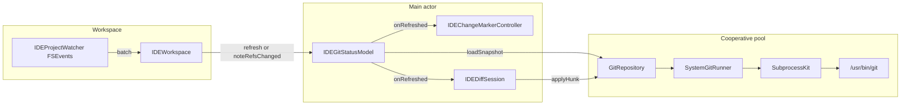

# Umbra Git backend audit

Date: 2026-11-11. Scope: the Git engine and its integration boundaries.

The findings below are the pre-repair audit. The repairs are in the tree. Read [Implementation outcome](#implementation-outcome) before treating a finding as still open. Phase 8 in the implementation plan (porcelain v2, rename and delete UI kinds, submodule status fields, a second repository per window) was not done.

Evidence is from reading `Packages/GitIntelligence`, `Packages/SubprocessKit`, and `Umbra/Sources/Umbra/Git`, plus the workspace watcher and diff session that call them. Two experiments were run against Apple Git 2.54.0 (`git version 2.54.0 (Apple Git-157)`): a throwaway repository under `/tmp` (removed afterward), and one read-only timing pass on `/Users/alex/Developer/Penumbra`. The Git test suites were not executed. They need a live display and a long `swift test` run. Coverage statements below come from reading the tests.

No P0 defect was confirmed. The success paths of stage, revert, and commit that the integration tests cover do not tear the index or delete uncommitted bytes. The P1 items can stage unintended files, hide a repository after a Git error, or record unsaved editor text in the index.

## 1. Executive summary

Umbra’s Git engine is a stateless wrapper around `/usr/bin/git`, in `GitRepository`, spawned through `SubprocessKit`. The app publishes state from one `@MainActor` model per window, `IDEGitStatusModel`. That split is the right one. The wrapper is tested against real Git for commit, revert, conflicts, rebase, stash, remotes, and linked-worktree metadata. Keep it. Do not move to libgit2.

The defects that matter are local:

- `stage`, `unstage`, and path-based `commit` omit `--literal-pathspecs`, so a file named `star*.txt` also stages `starX.txt`. Reproduced.
- The file watcher follows the project folder, not the resolved Git directory. A project opened below the repository, a linked worktree, or a submodule misses index and ref updates until the app becomes active.
- A failed `git status` is published as “this folder is not a repository,” which clears the last good snapshot.
- Hunk staging applies the diff viewer’s in-memory text with `git apply --cached`. A dirty editor buffer is that text, so the index can hold bytes that are neither `HEAD` nor the file on disk. The Changes-panel commit then commits the index.
- Every refresh asks for ignored files. On this checkout that command took 5.14s and returned 861 bytes. The same status without `--ignored` took 0.05s and returned nothing. This is one sample, not a monorepo benchmark.

Typing does not call Git. Gutter marks debounce off the main actor against a cached `HEAD` blob.

## 2. Current feature inventory

Implemented in `GitRepository` unless noted. Umbra wires these through `IDEGitStatusModel`.

| Area | Behavior | Where |
|---|---|---|
| Discovery | `rev-parse --show-toplevel --absolute-git-dir` | `GitRepository.discover` |
| HEAD and in-progress operation | Read from the Git directory, no process | `GitRepositoryState.read` |
| Status | Porcelain v1, NUL-delimited, optional ignored | `status(includingIgnored:)` |
| Stage / unstage file or all | `git add`, `git restore --staged` | `stage`, `unstage`, `stageAll`, `unstageAll` |
| Hunk stage / unstage | `git apply --unidiff-zero --cached` | `applyPatch` |
| Commit | Index when `paths` is empty; `--only` when paths are set. Amend, sign-off, skip hooks | `commit` |
| Revert | Restore from `HEAD` in index and work tree; skip paths absent from `HEAD` | `revert` |
| Diff text | Unstaged, staged, `HEAD`, commit, untracked via `--no-index` | `unstagedDiff`, `stagedDiff`, `workingTreeDiff`, `commitDiff` |
| Blob read | `HEAD`, index, commit, parent, ref, conflict stage | `fileContents(at:path:)` |
| Log, file log, line log, blame | `log`, `log -L`, `blame --contents -` | `log`, `lineHistory`, `blame` |
| Branches, tags, remotes | Create, switch, delete, rename, fetch, pull, push, force-with-lease | `GitRepository+Branches`, `+Remotes` |
| Merge, rebase, cherry-pick, revert, reset | Stop versus error from the operation files | `GitRepository+Operations`, `+History` |
| Interactive rebase | Todo file and `GIT_SEQUENCE_EDITOR`, no editor UI | `interactiveRebase` |
| Stash and smart checkout | Stash, pop, and `preservingLocalChanges` | `GitRepository+Stash` |
| Conflicts | `ls-files -u`, checkout `--ours`/`--theirs`, or write and `add` | `conflictStages`, `resolve` |
| Clone, init, ignore patterns | Static clone and `GitIgnoreWriter` | `GitRepository+Clone` |
| Worktree list/add/remove | Porcelain worktree list | `GitRepository+Worktree` |
| Credentials | Umbra askpass helper; background fetch uses batch mode | `IDEGitAskPass`, `IDEGitStatus+Remote` |
| Gutter | Live buffer versus cached `HEAD` blob, not the index | `IDEChangeMarkerController` |
| Agent | Status, diff, commit of named paths, branch create/switch | `IDEAgentGitTools` |

Absent, and not treated as defects by themselves: submodule update, multi-repo workspaces, bare-repo editing, commit of a selected line range as its own API (hunk apply exists), and a generation-stamped snapshot type.

## 3. Architecture

### Components

| Component | Responsibility | Depends on | Owns state? |
|---|---|---|---|
| `GitRepository` | One work tree. One or two Git invocations per method. | `GitRunning` | No. Value type. |
| `SystemGitRunner` | `/usr/bin/git`, argv, progress, command observer | `SubprocessKit` | No |
| `GitRepositoryState` | HEAD and merge/rebase/cherry-pick/revert/bisect | The Git directory on disk | No. Read on demand. |
| `IDEGitStatusModel` | Published status, log, branches, commit box, sheets, tasks | `GitRepository` via `IDEGitSupport` | Yes, per window |
| `IDEProjectWatcher` | One FSEvents stream for the project and open files | Project URL | Watch paths only |
| `IDEChangeMarkerController` | Gutter versus `HEAD` | Model’s `headContents` | Bounded blob cache |
| `IDEDiffSession` | Line chunks and hunk apply | `IDEDiffComputer`, model | Viewer state |
| `IDEAgentGitTools` | Agent status, diff, commit, branch | `GitRepository` directly | No |

`Penumbra` and `EditorIntelligence` do not link `GitIntelligence`. `GitIntelligence` depends only on `SubprocessKit`.

### Data flow for a refresh

1. `IDEWorkspace.subscribeToProjectWatcher` calls `gitStatus.refresh()` on any in-root batch, and `noteRefsChanged()` when the batch says refs or an operation file changed.
2. `refresh` starts one task. A second call sets `needsAnotherPass`.
3. `loadSnapshot` discovers if needed, then runs status, branch, branch list, sync status, and `state()`.
4. Back on the main actor, `apply` replaces the published fields and reloads the selected diff text.
5. `onRefreshed` reloads every diff session, drops the `HEAD` cache, and re-diffs open editors.

### Process invocation

Every Umbra Git child goes through `IDEGitSupport.runner`, a `SystemGitRunner` whose observer appends non-read-only commands to `IDEGitCommandStore` (last 500). Arguments are an array. The runner inserts `-c core.quotepath=off`. Reads insert `--no-optional-locks`. The working directory is the work-tree root. Stdout and stderr are both captured in full (`OutputCapture.all`). Progress parses stderr while the process runs.

There is no shell, except `GIT_SEQUENCE_EDITOR`, which Git itself runs in a shell. The value is `cp` plus `GitRebasePlan.shellQuoted` of a path under the Git directory.

### Coupling

- The agent and the panel can mutate the same repository with no shared lock.
- `IDEGitStatusModel` imports AppKit and owns the sheet queue. A UI-only change has to touch the state owner.
- `IDEGitChange` drops `GitStatusEntry.originalPath` and maps `D`, `R`, and `C` to `.modified`.
- Two diff implementations: Git’s unified diff for the Changes text, and `IDEDiffComputer.lineChunks` for the viewer, gutter, and merge tool. The second one does not import SwiftUI. It lives in the app target because the gutter and the merge viewer already share it.

## 4. State ownership

| Fact | Authoritative source | Copy |
|---|---|---|
| Work tree and Git directory | `GitRepository` after `discover` | `IDEGitStatusModel.repository` |
| HEAD, operation in progress | `GitRepositoryState.read` on each refresh | `repositoryState` |
| Branch name shown in the model | `currentBranch()` during `loadSnapshot` | `currentBranch` |
| Ahead/behind | `branchList()` (`%(upstream:track)`) and again `syncStatus()` | `branchInfos`, `sync` |
| Index versus work tree | `git status --porcelain=v1 -z` | `changes`, `statuses` |
| `HEAD` blob for the gutter | `fileContents(at: .head)` | `IDEChangeMarkerController` cache, 128 entries or 32 MB |
| Unsaved editor | The document buffer | Substituted only when a diff session loads a working-tree side |
| Log | `git log` when `historyStale` | `commits` |

Four states stay distinct inside `GitRepository`: `GitRevision.head`, `.index`, the work tree (`git diff` and disk reads), and caller-supplied bytes (`blame --contents`). The diff session collapses the last two for the working-tree side. The gutter compares the buffer with `HEAD` only, so a staged change with a clean buffer still paints until commit. That matches the product note in `Umbra/CLAUDE.md`. It is a different question from “what is staged.”

`GitSnapshot` inside the model has no generation. `refresh` publishes whatever load finished, then starts another load if `needsAnotherPass` was set. An older load can paint, and the follow-up corrects it.

A failed load is the same value as “not a repository”: `(nil, GitSnapshot())` from `loadSnapshot`. See finding F3.

## 5. Concurrency

`IDEGitStatusModel` is `@MainActor`. `loadSnapshot`, history, and diff loads are `nonisolated` and run off that actor. `SubprocessRunner.run` waits with a continuation. Pipe reads sit on a dispatch source, not the cooperative pool. `runBlocking` exists and Git does not use it.

Tasks stored on the model: `refreshTask`, `diffTask`, `actionTask`, `historyTask`, `commitDetailTask`, `networkTask`, `autoFetchTask`. `setRoot` cancels all of them. The `NotificationCenter` observer registered in `init` is not removed. The closure captures `weak self`, so a closed window’s model can die. Each new model adds another observer for the life of the process.

`runGitAction` cancels the previous local task before starting another. Network work uses a separate task and is left running. A pull and a commit can overlap. Git’s `index.lock` makes one of them fail.

Cancellation of a child is SIGTERM, then SIGKILL after `terminationGrace` (2 seconds). `processGroup` is false, so a hook or `ssh` child is not in the killed group. A leftover `index.lock` after SIGKILL is inferred from that mechanism. It was not reproduced.

The gutter task stores a content generation and drops a result if the buffer moved. That path is in good shape.

No `nonisolated(unsafe)` shared Git cache was found. `ProgressRelay` and the command observer hop to the main actor through a lock or a `Task`. `GitRepository` is `Sendable`. The runner is a struct.

## 6. Correctness findings

### F1 — P1. Pathspecs are not literal on stage, unstage, and path commit

**Where.** `GitRepository.stage` (`git add --`), `unstage` (`git restore --staged --`), `commit` when `paths` is non-empty (`git commit --only --`). `revertToHead`, `pathsInHead`, `listedFiles`, and conflict `add`/`rm` already pass `--literal-pathspecs`.

**Evidence.** On Git 2.54, in a throwaway repo, `git add -- 'star*.txt'` staged both `star*.txt` and `starX.txt`. `git --literal-pathspecs add -- 'star*.txt'` staged only `star*.txt`. `testPathsWithSpacesNonASCIIAndGlobCharactersAreLiteral` covers `pathsInHead` and `revert`, not `stage`.

**Impact.** The Changes panel stages one relative path (`IDEGitStatusModel.stage`). A name containing `*`, `?`, or `[` stages every match. `IDEGitCommitTool` commits the caller’s paths through `commit`, so the same name can commit extra files. The panel’s own commit passes `paths: []` and commits the index; it is not on this path. `git commit --only` also records the work-tree bytes of the named paths. That matches the agent tool’s stated “version on disk” behavior. The glob is the defect.

**Correction.** Pass `--literal-pathspecs` on those three methods. Chunk path lists at 200, as `revertToHead` does, so a large selection cannot hit `ARG_MAX`.

**Verify.** Integration test: files `star*.txt` and `starX.txt`, stage only the first, assert `git status` shows only that path staged. Repeat for unstage and for `commit(paths:)`.

### F2 — P1. The watcher does not follow the Git directory

**Where.** `IDEProjectWatcher.setRoot` watches the project URL. `IDEWorkspace.applyProjectRoot` passes that same URL. `record` treats a path as Git metadata only when it contains `/.git/` under the canonical project root. `isRelevant` returns false for a path ending in `/.git`.

**What works.** An ordinary repository whose `.git` is a directory inside the opened folder. `index`, `HEAD`, `refs/**`, and operation files set `gitMetadataChanged`, `gitRefsChanged`, or `gitOperationChanged`. The subscription refreshes, and ref or operation events also call `noteRefsChanged()`.

**What does not.** `discover` binds the parent repository when the project is a subdirectory, and `status()` is unscoped, so the panel lists the whole repo. The watcher still watches only the subdirectory. A linked worktree’s Git directory is `<main>/.git/worktrees/<name>` (`GitRepositoryStateTests.testALinkedWorktreeReadsItsOwnHeadAndOperation` already asserts the path). A submodule’s `.git` is a file; the module directory lives elsewhere. None of those directories are in the FSEvents roots. A terminal `git add` or commit then changes no watched file. The log stays stale until `didBecomeActiveNotification`, which calls `noteRefsChanged()` and `refresh()`. A checkout that rewrites watched files still refreshes status, without marking history stale, so the branch label can move while the log does not.

**Impact.** External staging and commits look ignored in a subdirectory project, a linked worktree, or a submodule checkout, until the user switches away from Umbra and back.

**Correction.** After discover, also watch `repository.gitDirectory`. Map `HEAD`, `refs/`, and operation files there to the same batch flags. Coalesce as today when `.git` is already inside the project.

**Verify.** Temp repo, open a subdirectory as the model root, commit in the parent, assert the model’s branch and status stay stale until an event is delivered for the parent `.git`. Repeat with a linked worktree whose Git directory is outside the work tree. This was not run inside the app; the watch roots are what the code subscribes to.

### F3 — P1. A failed status refresh clears the repository

**Where.** `IDEGitStatusModel.loadSnapshot` uses `try?` around `repository(for:)` and `status`. Failure returns `(nil, GitSnapshot())`. The refresh task assigns `repository = nil` and `apply`s that snapshot when the task is not cancelled. `isRepository` is `repositoryRoot != nil`, so the window forgets the repo.

**Evidence.** Cancellation is checked before `apply`, so a cancelled load does not clear state. A real `GitError.failed` is not cancellation. `--no-optional-locks` on reads avoids the usual “index is locked” failure. It does not cover dubious ownership, a corrupt index, or any other non-zero status. Those are published as an empty repository. The next successful refresh restores it, if something calls `refresh` again.

**Impact.** A persistent Git error hides source control. A transient error flashes an empty panel and an empty branch label.

**Correction.** Keep the last good snapshot and store the error beside it. Publish loading, stale, and failed as different values.

**Verify.** A `GitRunning` that fails `status` after a good snapshot. Assert `currentBranch` and `changes` remain, and an error string is set.

### F4 — P1. Hunk staging can put the unsaved buffer into the index

**Where.** `IDEWorkspace.makeDiffSession` returns `unsavedEditorText(atPath:)` for a working-tree side when an editor is dirty. `IDEDiffSession.applyToIndex` builds `IDEDiffPatchBuilder.patch` from the in-memory sides and calls `applyHunk`. `GitRepository.applyPatch(_:toIndex:reverse:)` runs `git apply --unidiff-zero --whitespace=nowarn --cached`. Nothing writes the disk file. `performCommit` calls `commit` with `paths: []`, which commits the index.

**Evidence.** `git apply` checks that the `-` lines match, so a stale line number usually fails. There is no comparison against the index blob id (`:path`) before apply. When the `-` lines still match and the `+` lines came from the dirty buffer, apply succeeds and the index holds editor-only bytes. The agent tool’s approval note says the opposite: a commit sees the file on disk.

`testApplyPatchStagesAndUnstagesOneHunk` covers a patch applied to a file that was written to disk. It does not cover a dirty buffer.

**Impact.** A later panel commit records text the user has not saved. The work-tree file can still be the old bytes, so status then shows a new unstaged diff that reverses the hunk.

**Correction.** Refuse hunk staging while the editor for that path is dirty, or require a save first. Record the index blob id and refuse the apply if it changed. After apply, compare `git rev-parse :path` with the expected blob. Do not treat a zero exit alone as proof.

**Verify.** Dirty buffer containing an extra line, stage one hunk, assert the index blob and the file on disk. The index must not contain the unsaved line.

### F5 — P2. `--ignored` is on every refresh

**Where.** `loadSnapshot` calls `repo.status(includingIgnored: true)`, which appends `--ignored` to `git status --porcelain=v1 -z --untracked-files=normal`.

**Evidence.** One sample on this checkout, Apple Git 2.54, clean work tree, read-only:

| Command | Time | Output |
|---|---|---|
| `git --version` | 0.01s | |
| `rev-parse --show-toplevel --absolute-git-dir` | 0.01s | |
| `status --porcelain=v1 -z --untracked-files=normal` | 0.05s | 0 bytes |
| same command plus `--ignored` | 5.14s | 861 bytes |
| `for-each-ref` heads and remotes | 0.01s | |

The 5.14s is Git walking ignored trees. Swift parsing of 861 bytes is not the cost. This number is not a monorepo result and was not repeated.

**Impact.** Every FSEvents batch and every save calls `refresh()`. `needsAnotherPass` keeps a single scan in flight plus one follow-up. The scan is off the main actor, so typing is not blocked. The panel stays stale for the length of the scan. Explorer ignored-ancestor coloring (`status(for:isDirectory:)`) is why the flag is on.

**Correction.** Default refresh omits `--ignored`. Load ignored paths on a slower pass, or only for directories the explorer has expanded.

**Verify.** Time both commands again on this repo after the change, and on a fixture with a large ignored directory. Record process count per refresh from a test observer.

### F6 — P2. Every successful refresh drops `HEAD` blobs and reloads every diff

**Where.** `IDEWorkspace.init` sets `gitStatus.onRefreshed` to `refreshBlameInOpenEditors`, `reloadDiffSessions`, `changeMarkers.invalidateHeadCache`, and `refreshChangedLinesInOpenEditors`. `IDEGitStatusModel.refresh` calls `onRefreshed` after every applied snapshot, including a save that did not move `HEAD`.

**Evidence.** The cache caps are 128 entries and 32 MB (`IDEChangeMarkerController.maxHeadCacheEntries`, `maxHeadCacheBytes`). Invalidation clears all of them. The next gutter refresh calls `headContents`, which is `git cat-file blob HEAD:<path>`, once per open file that missed the cache.

**Impact.** A one-file save re-reads every open file from Git and recomputes every diff tab. Combined with F5, that work starts after a multi-second status.

**Correction.** Drop a path’s blob when that path’s `HEAD` id changes. Drop the whole cache only when `repositoryState.head` changes. Reload a diff session when its file’s index or work-tree side changed.

**Verify.** Save an unstaged file, assert the cache still holds other paths’ blobs. Commit, assert the cache is empty.

### F7 — P2. Stale publish, and mutations are not fenced

**Where.** `refresh` and `runGitAction` in `IDEGitStatus.swift`. `SubprocessRequest.terminationGrace` and `processGroup` in `SubprocessRequest.swift`.

**Evidence.** `needsAnotherPass` avoids a lost update and still applies the older snapshot first. There is no generation on `GitSnapshot`. A new local action cancels the previous task. That sends SIGTERM and, after 2 seconds, SIGKILL to the Git process only. Starting a stage while a commit runs kills the commit. `setRoot` does the same. Network actions do not cancel local ones. Two windows each have a model and no shared lane.

A leftover `index.lock` after SIGKILL was not reproduced. Git writes the index under that lock and removes it on a normal exit. SIGKILL skips that cleanup. Treat the stuck lock as a risk, not as a confirmed incident.

**Impact.** The panel can flash a pre-commit status. Overlapping pull and commit fail one side with a lock error. If that error hits `loadSnapshot`, F3 clears the model. Killing a commit mid-hook can leave the hook running and the lock file behind.

**Correction.** One mutation lane per Git directory, shared by windows with the same `gitDirectory`. Local actions wait or refuse. They do not kill a commit. Stamp each snapshot with the generation captured when the load started, and ignore an apply from an older generation. A status that loses to `index.lock` stays “busy” and keeps the last snapshot.

**Verify.** Two tasks call `commit` on one temp repo. Both end with `git ls-files -s` matching the expectation, and `index.lock` is absent. A slow status started before a commit does not paint over the commit’s snapshot.

### F8 — P2. The app model is the integration seam

**Where.** `IDEGitStatusModel` (`import AppKit`, `IDEGitSheetQueue`, `commitMessage`, selection). `IDEGitStatus.parse` builds `IDEGitChange` without `originalPath`. `statusFromIndexChar` / `statusFromWorkTreeChar` map `D`, `R`, and `C` to `.modified`.

**Evidence.** `GitRepository` is already free of AppKit, SwiftUI, Metal, and CoreGraphics. The panel, the branch popup, and the agent do not share a snapshot type. Conflict detection itself is sound: `GitStatusEntry.isConflicted` treats `AA`, `DD`, and any `U` as conflicts, which covers `AU`, `UA`, `DU`, and `UD`.

**Impact.** A second UI cannot bind to repository state without taking sheets and selection along, or calling Git itself.

**Correction.** See the contract document. Keep `GitRepository`. Add a snapshot the model stores. Do not add a service framework.

**Verify.** The new snapshot type compiles in `GitIntelligence` with no Umbra import. The panel still builds.

### Repository lifecycle, checked against the code

| Situation | Result |
|---|---|
| Ordinary repo, `.git` directory | `discover` returns root and Git dir. Watcher sees metadata. |
| No commits yet | `symbolic-ref` returns the branch. `state()` reads `ref: refs/heads/...`. Status works. |
| Detached HEAD | `currentBranch()` falls through to `rev-parse --short`. `state().isDetached` is separate. |
| Project inside a repo subdirectory | `discover` walks up. Status is the whole repo. Watcher does not see the parent `.git` (F2). |
| Nested repo inside the project | The project root’s `discover` binds the outer repo. The inner repo is not a second model. |
| Linked worktree | `discover` and `state()` use `.git/worktrees/<name>`. Watcher on the work tree does not (F2). |
| Submodule | `.git` file is handled by `rev-parse --absolute-git-dir` if that directory is the project. No submodule update API. Porcelain v1 reports a submodule as `M`. |
| Bare repo | `--show-toplevel` fails. `discover` returns nil. Reasonable for an editor. |
| `.git` file (worktree or submodule) | Discovery uses the absolute Git dir. The watcher looks for a `/.git/` directory (F2). |
| Repo deleted while open | The next status fails and, today, clears the model (F3). |
| Two windows | Two models, two watchers, two refreshes, no shared mutation lane (F7). |
| External branch switch | Seen when `.git` is inside the project. Otherwise delayed until activate (F2). |
| `setRoot(nil)` / switch project | Tasks cancelled, askpass session unregistered, sheets cancelled. Observer block remains. |

Unstaged renames arrive as a deletion plus an untracked file. That is Git’s porcelain until the rename is staged. The staged `-z` order was checked: `R  new.txt\0old.txt\0`. `GitStatusParser` stores `path == new.txt` and `originalPath == old.txt`. `man git-status` describes that reversed `-z` order. The parser is correct. The model then drops `originalPath`.

## 7. Performance findings

Measured: F5 only. Everything else in this section is a static count from `loadSnapshot` and `loadHistory`.

A refresh with a cached `GitRepository` invokes:

1. `status` with `--ignored` (the 5.14s sample).
2. `currentBranch`: `symbolic-ref`, and `rev-parse --short HEAD` when detached or unborn.
3. `branchList`: one `for-each-ref`.
4. `syncStatus`: `rev-parse @{u}`, `rev-list --left-right --count`, then up to two `log`s and a `remote` when ahead or behind is non-zero. Ahead/behind is already on each `GitBranch` via `%(upstream:track)`.
5. `state()`: file reads, no process.

When `historyStale` is set (refs, operation files, activate, or a finished action):

6. `log` (default limit 300, `--all` unless a branch filter is set).
7. `branches()`: a second `for-each-ref`.
8. `authors()`: `log --all -n 5000 --format=%an` when the author list is stale.

Then `onRefreshed` can add one `cat-file` per open file (F6).

Spawn overhead on this machine is about 10ms (`git --version` 0.01s). Batching the branch and status queries would save milliseconds. Removing `--ignored` from the hot path is the change with a measured effect.

No cache hit rate exists. Status is not cached inside `GitRepository`. The model replaces the whole dictionary when the new value differs.

Large output stays in memory (`OutputCapture.all`). A huge `git log` or `git blame` can allocate without a cap. Status on this repo did not. Unmeasured for a repository with hundreds of thousands of untracked files.

The gutter path is bounded: 400ms debounce, one task per text view, generation check, diff off the main actor, Myers skipped when the uncommon middle exceeds 20,000 lines.

## 8. Security and data-loss risks

| Risk | Severity | Notes |
|---|---|---|
| Glob pathspec stages or commits extra files | P1 | F1. Those files can then be committed. |
| Unsaved buffer recorded in the index and committed | P1 | F4. |
| `switch --discard-changes` and `reset --hard` | Intentional | `forceCheckout` is only reached from the confirmation sheet. Hard reset is a destructive button in `IDEGitSheetViews`. |
| `revert` / `revertToHead` | Intentional | Discards staged and unstaged bytes for paths that exist in `HEAD`. Paths that do not are skipped. Tested. |
| SIGKILL during `git add` or `git commit` | P2, inferred | F7. Can leave `index.lock` or an orphaned hook. Not reproduced. |
| Interactive rebase reword runs `git commit --amend --no-verify` | P3 | `GitRebasePlan.amend`. That amend skips hooks. The todo path is shell-quoted. |
| `preservingLocalChanges` on a failed operation | P3 | The `catch` does `_ = try? await stashPop()` and rethrows the original error. A pop that also fails is invisible. The success path reports `.keptInStash` and `.restoredWithConflicts`. |
| Credentials | Sound | Askpass is a per-launch socket and token. Umbra does not store passwords. Background fetch uses `BatchMode` and cannot open a sheet. |
| Argument injection | Sound | Argv arrays, `--` before branch names, leading `-` rejected. The glob in F1 is the pathspec hole. |
| `safe.directory` / dubious ownership | F3 | Git refuses, and the model currently shows no repository. |

## 9. Missing capabilities

These are gaps, not failed implementations. Priority is in the implementation plan. None of them block the P1 repairs.

- Submodule update, init, and absorb. Clone can pass `--recurse-submodules`.
- More than one repository per window.
- Bare repositories.
- Rename and delete as their own status kinds in `IDEGitChange`.
- File-mode-only changes as a status. Git’s text diff still contains the mode lines.
- A timeout on a hook that ignores SIGTERM.
- Porcelain v2, which can return branch, ahead/behind, and status in one process. Worth doing only if a profile still shows too many spawns after F5.

## 10. Architectural simplification

Worth doing:

- One snapshot type shared by the panel and the agent, stored by the model, produced by `GitRepository`.
- Stop computing ahead/behind twice (`branchList` and `syncStatus`) once the snapshot has a single field.
- Let `IDEGitChange` carry `originalPath` and a real delete/rename, or have the panel read `GitStatusEntry`.

Not worth doing:

- Replacing `GitRepository` with libgit2 or a plugin protocol. `GitRunning` is already the test seam and has one production implementation.
- Splitting the model into a stack of coordinators before the snapshot exists. Selection, sheets, and the commit box can stay on `IDEGitStatusModel`.
- Moving `IDEDiffComputer` into `GitIntelligence`. It is the editor’s line diff. The engine should return bytes and unified diff text.

`GitCommit` versus `IDEGitCommit` is a presentation split (graph row, relative date). Keep it.

## 11. Test coverage gaps

What exists is real Git in a temp directory, skipped when `/usr/bin/git` is missing. Library tests live in `Tests/PenumbraTests` (`GitRepositoryIntegrationTests`, `GitOperationsIntegrationTests`, `GitHistoryIntegrationTests`, `GitRemoteIntegrationTests`, `GitStashIntegrationTests`, `GitRepositoryStateTests`, `GitParsersTests`, `SystemGitRunnerTests`, `GitCloneIntegrationTests`, `GitRebasePlanTests`). Umbra tests drive `IDEGitStatusModel` the same way (`IDEGitStatusOperationsTests`, history, remote, commit checks, stash, askpass, clone, diff tabs, merge computer, agent tools).

Absent, in the order they should be added:

1. Literal `stage` / `unstage` / `commit(paths:)` (F1).
2. Failed status does not clear a good snapshot (F3).
3. Subdirectory project and linked worktree: an external commit is invisible until the Git directory is watched (F2).
4. Hunk apply versus `git rev-parse :path`, including a dirty buffer (F4).
5. Two overlapping commits, then `git ls-files -s`, and no `index.lock` (F7).
6. Cancelled status does not `apply`. Cancelled commit has an asserted outcome.
7. Newline in a filename on stage. Leading-dash branch names are already rejected.
8. A timed status with and without `--ignored` on a fixture that has a large ignored tree (F5). Not a correctness test.

Details are in `GIT_BACKEND_TEST_STRATEGY.md`.

## 12. Recommendations by priority

1. Literal pathspecs on `stage`, `unstage`, and path `commit`, with the glob regression test (F1).
2. Keep the last good snapshot when status fails (F3).
3. Watch `gitDirectory` after discover (F2).
4. One mutation lane per Git directory, and a generation on the snapshot (F7).
5. Hunk apply preconditions: no dirty buffer, check the index blob (F4).
6. Take `--ignored` off the default refresh, and stop flushing the `HEAD` cache on every refresh (F5, F6).
7. Add the snapshot type in `GIT_BACKEND_API_CONTRACT.md` and keep the panel as its consumer (F8).
8. Only then consider porcelain v2, rename/delete kinds, and submodules.

## Implementation outcome

Repairs landed on 2026-11-11 in the existing `GitRepository` and `IDEGitStatusModel`. No libgit2 migration, no new service layer, and no Git UI redesign. Git still runs off the main actor through `SystemGitRunner`.

| Finding | What changed |
|---|---|
| F1 pathspecs | `stage`, `unstage`, path `commit` (the untracked `add` and the `--only` list), `stash push` when paths are set, and path-scoped `log` / diff / `blame` pass `--literal-pathspecs` before the subcommand. `add`, `restore --staged`, and `restore` to `HEAD` are chunked at 200 paths. `commit --only` and `stash push` stay one invocation. |
| F2 watcher | When `discover`’s git directory is outside the project, `IDEProjectWatcher.setGitDirectory` adds that directory to the one FSEvents stream. `index`, `HEAD`, refs, and operation files refresh. `objects/` does not. `setRoot` and `stop` drop the extra root. An in-project `.git` is not watched twice. |
| F3 failed status | A failed `status` keeps the last snapshot and sets `GitRefreshState.failed`. Discover’s “not a git repository” is `.unavailable`. Cancellation does not publish a failure. A load whose epoch is older than `refreshEpoch` is dropped. |
| F4 hunks | `IDEDiffSession.applyToIndex` refuses a dirty right side and an unsaved editor buffer before building a patch. `GitRepository.applyHunk` checks the index blob (`:path`) and then `git apply --cached`. Paths with a space are quoted in the diff header. A newline, quote, or backslash is rejected. |
| F5 ignored | The hot refresh calls `status(includingIgnored: false)`. A later pass calls `status(includingIgnored: true)` and merges only `!!` rows. Its failure does not set `refreshError`. |
| F6 HEAD cache | `onRefreshed` calls `invalidateHeadCache` only when `headMoved` is true. Diff tabs reload the paths whose status changed, plus paths the watcher invalidated. |
| F7 lane | `GitMutationLane.shared` runs one mutation at a time per resolved git directory. `runGitAction`, `applyHunk`, and the agent commit and branch tools enter it. A new mutation waits. It does not cancel the one that is running. Closing the window cancels that window’s tasks only. |
| F8 contract | `GitRepositoryID`, `GitWorkspaceSnapshot`, `GitRefreshState`, `GitHunkApply`, and `GitIndexCommit` are in `GitIntelligence`. The panel commits with `commitIndex`. The agent commits with `commitFiles`. |

`GitRefreshState` is `.unavailable`, `.loading`, `.stale`, `.idle`, or `.failed`. The plan’s three cases were not enough: a folder that is not a work tree is `.unavailable`, and a snapshot that a mutation has invalidated is `.stale` until the next load applies. `IDEGitChange.originalPath` is filled from porcelain. The change row’s kind is still `.modified` for a delete or a rename.

The hunk blob check compares `:path` for both stage and unstage. `git apply --cached` edits the index, so a `HEAD` id would not tell an unstage that the index had moved.

The lane is not inside `GitRepository`. `perform` for the same directory waits for the previous `perform`, so a nested call deadlocks. `preservingLocalChanges` (stash, operation, pop) is one lane entry at the call site.

### Measurements

Apple Git 2.54.0 (Apple Git-157). Three samples each, read-only, with `-c core.quotepath=off --no-optional-locks`. The checkout was dirty (about 1200 bytes of porcelain), so these are not the audit’s clean-tree sample.

| Command | Samples (s) | Median | Stdout |
|---|---|---|---|
| `rev-parse --show-toplevel --absolute-git-dir` on this checkout | 0.015, 0.017, 0.016 | 0.016 | 67 bytes |
| `status --porcelain=v1 -z --untracked-files=normal` | 0.067, 0.051, 0.050 | 0.051 | 1200 bytes |
| same, plus `--ignored` | 4.919, 2.134, 2.154 | 2.154 | 2159 bytes |
| `diff --numstat` | 0.034, 0.029, 0.027 | 0.029 | 924 bytes |
| `diff --cached --numstat` | 0.015, 0.014, 0.016 | 0.015 | 0 bytes |

The first `--ignored` sample (4.919s) is in the same range as the audit’s single 5.14s sample. The next two are about 2.15s. The hot path is the 0.051s command. The ignored pass still pays the slow command, off the status apply.

A `/tmp` fixture with one ignored directory of 8000 files was 0.015s without `--ignored` and 0.018s with it (Git reports the directory, not each file). A fixture of 1500 directories each holding one `*.log` was 0.053s either way, and `--ignored=matching` was the same. Those fixtures do not reproduce this checkout. `--ignored=matching` was not adopted. The background pass still uses `status(includingIgnored: true)`.

### Tests that were run

Passed:

- `swift test --package-path Packages/GitIntelligence`: `GitMutationLaneTests` (overlap depth 1, a cancelled waiter does not run) and `GitWorktreeParserTests`.
- `swift test --filter GitRepositoryIntegrationTests`: 31 tests, including literal pathspecs (`star*.txt` against `starX.txt`, `?`, brackets, a leading hyphen, a space, `café.txt`, a newline), hunk blob check, a patch that does not match, a rename, a deletion that leaves another index blob alone, and `commitIndex` versus `commitFiles`.
- `swift test --filter GitRepositoryStateTests`: 10 tests.
- `swift test --package-path Umbra --filter IDEGitRefreshTests`: failed status keeps `main` and recovers, a non-repo stays `.unavailable`, cancellation does not publish a failure, a stale epoch cannot replace a newer one, the first `status` omits `--ignored`.
- `IDEDiffHunkSafetyTests`: a dirty right side and an unsaved-editor provider do not call apply; a clean hunk sends the loaded text and the captured blob id.
- `testASpaceInThePathIsQuotedAndANewlineIsRejected` and `testGitDirectoryClassification`.
- `swift test --package-path Umbra --filter 'IDEGit|testAnExternalGitDirectory|testGitDirectoryClassification'`: 108 tests, 0 failures. That includes the existing Git model suites (history, operations, remote, stash, commit, clone, askpass) and `testAnExternalGitDirectoryReportsHeadAndSkipsObjects`.

The Umbra package test run compiled the `Umbra` target (Swift 6). That is the application build that was executed. A release build was not run.

### Still true

- Status is the whole repository, not the opened subdirectory.
- Nested submodule git directories are not watched unless that submodule is the opened project.
- Explorer ignored coloring is unknown until the slow pass returns. A failure of that pass leaves those paths unknown.
- `AsyncStream` of refresh state was not added. The panel reads the `@Observable` model.
- The `NotificationCenter` observer in `IDEGitStatusModel.init` is still not removed. The closure is `[weak self]`.
- `preservingLocalChanges` still swallows a failed `stash pop` after the wrapped operation throws.
- The lane keeps one finished task per git directory for the process. It does not grow per operation.
- `index.lock` after a killed commit was not reproduced. Cancellation is still SIGTERM, then SIGKILL after 2 seconds, on that Git process.
- The blob check and `git apply` are two processes. Another Git process can change the index between them. Umbra’s own mutations for that git directory cannot: they share the lane.
- Push and pull commit lists fill in a follow-up task. Counts come from `branchList` on the hot path.
- The first successful refresh reports `headMoved`, because the previous head is `.unknown`, and clears the `HEAD` cache once.

## Libgit2

Stay on the Git CLI. The engine’s value is the user’s Git: hooks, ssh, askpass, smudge and clean filters, rebase, worktrees, and whatever Apple Git 2.54 already does. Process startup measured here is about 10ms. The expensive call is `status --ignored`, which a library would still have to walk. libgit2 would mean a C dependency, a second semantics for the index, and missing hook and credential-helper behavior. `GitRunning` remains the seam for tests.

## Closing health

| Area | Assessment |
|---|---|
| Correctness | The four P1 holes in the original table are repaired and covered by the tests in the outcome section. Remaining limits are listed there. |
| Architecture | Unchanged decision: keep `GitRepository` and `IDEGitStatusModel`. The lane and the snapshot types sit on that seam. |
| Concurrency | Git work stays off the main actor. One mutation lane per git directory. Refresh applies only the current epoch. A cancelled load does not clear a good snapshot. |
| Performance | On this checkout, 2026-11-11, hot `status` median 0.051s (three samples). The same command with `--ignored` median 2.154s, first sample 4.919s. The hot path no longer passes `--ignored`. |
| Scalability | Hot status is still a full-repo porcelain walk, without the ignored walk. The ignored pass remains whole-repo and slow on this checkout. |
| Tests | The suites named in the outcome section were executed and passed. The full Umbra suite and a release build were not. |
| UI integration | A UI agent can read `GitWorkspaceSnapshot`, `GitRefreshState`, `GitHunkApply`, and `commitIndex` / `commitFiles`. It should keep using `IDEGitStatusModel` for sheets and selection. It should not spawn `git`. |
