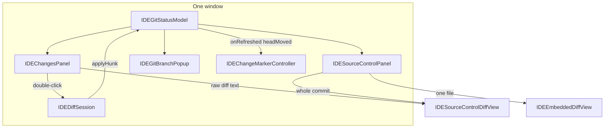

# Umbra Git frontend audit

Date: 2026-11-11. Scope: the Git user interface in `Umbra/Sources/Umbra` and the editor decorations it drives. The engine contract is `GIT_BACKEND_API_CONTRACT.md`. Backend phases 1–7 are in the tree. Phase 8 was not done.

This is an audit of the current interface. It does not change production code. Evidence is from reading the views, the model, the diff session, the gutter, and the command registry. No UI test was run, and no timing was taken. Performance notes name the code path and the measurement that would confirm it.

The panel already calls `IDEGitStatusModel`. It does not spawn `git`. Keep that.

## Final review

1. **What works and should stay.** One `IDEGitStatusModel` per window. Changes in the left sidebar, history in the bottom panel. The commit box and `IDEGitCommitChecks`. The operation banner and the three-pane merge tool. `IDEDiffViewerView` on Penumbra `TextView`s. The gutter stripe (`GutterChangeView`), shared by Metal and Core Graphics, filled off the keystroke. The branch popup, stash list, paged log, compare tab, console, and the confirmations on discard, abort, hard reset, and force checkout. Design tokens in the SwiftUI chrome. Commands through `EditorCommand` and `IDEMenuShortcuts`.

2. **The ten problems that matter.** (1) A first status failure is indistinguishable from a folder that is not a repository. (2) The word Revert discards local work in Changes and creates a revert commit in the log. (3) Deletes and renames are painted as modified, and `originalPath` is unused. (4) Stage and unstage have no context-menu item and no command. (5) The Changes preview is a second diff, with a light-on-dark band, beside a viewer that already exists. (6) `.loading` and `.stale` never reach the screen. (7) “Pull” in the sync section is fast-forward only, while Update Project merges or rebases. (8) The Explorer communicates Git by color, and editor tabs communicate it not at all. (9) The gutter stripe cannot be walked from the keyboard. (10) Change rows and hunk buttons do not speak their action to VoiceOver.

3. **Improve these.** `IDEChangesPanel`, `IDESourceControlChangeRow`, `IDEConflictRow`, `IDEFileTreeView`’s row label, `IDEChangeMarkerController` (commands only), and the Git entries in `IDEWorkspace.registerPaletteCommands` / `IDEMenuShortcuts`. Read `GitRefreshState` and `workspaceSnapshot.entries`. Leave `IDEGitStatusModel` as the owner of sheets, selection, and the commit box.

4. **Replace this one path.** The selected-file use of `IDESourceControlDiffView` should become `IDEEmbeddedDiffView` with `IDEDiffRequest.change`. Keep the text view for a whole-commit patch until that patch has a viewer. Do not replace `IDEDiffViewerView`, `IDEDiffSession`, `IDEMergeViewerView`, or `GitRepository`.

5. **Workflows the backend can already do and the keyboard cannot.** Stage, unstage, commit without the message field already focused, next and previous editor change, next conflict. Worktree list, add, and remove exist on `GitRepository` and have no UI. Commit, amend, discard, branch switch, fetch, update, push, history, stash, conflicts, rebase, and cherry-pick already have a menu, a sheet, or the banner.

6. **Most value, least risk.** Show a failed first status. Label delete and rename from `GitStatusEntry`, which the snapshot already holds. Put Stage and Unstage on the context menu and the existing command registry. Give each change row an accessible name. None of that adds a Git process or a view model.

7. **The UI work does not need a backend contract change.** `GIT_FRONTEND_BACKEND_GAPS.md` lists the items that stay out of SwiftUI.

8. **Build first** the honest Changes list (phase 1 of `GIT_FRONTEND_IMPLEMENTATION_PLAN.md`). Then the commands. Then embed the existing diff viewer. Then editor navigation.

## 1. How the interface is put together

| Surface | Type | Role |
|---|---|---|
| Changes sidebar | `IDEChangesPanel` | Commit box, conflicts, staged, unstaged, inline text preview, unsynced commits |
| History bottom tab | `IDESourceControlPanel` | Log, Stashes, Compare, Console. The tool window title is “History” (`IDEToolWindows`) |
| Diff tab | `IDEDiffViewerView` | Side-by-side or unified Penumbra text views |
| Merge tab | `IDEMergeViewerView` | Three Penumbra text views inside a `.diff` document |
| Toolbar | `IDEGitBranchPopup` | Branch, tags, update, push, checkout |
| Explorer | `IDEFileTreeView` | Name and icon tint from `status(for:isDirectory:)` |
| Editor | `IDEChangeMarkerController` | Gutter versus `HEAD` |

`showsSourceControlTab` is `gitStatus.isRepository`, and `isRepository` is `repositoryRoot != nil` (`IDEWorkspace`, `IDEGitStatusModel`). The Changes tab, the History tab, and the Git menu items all key off that Boolean.

A developer can see the current branch in the toolbar, ahead/behind at the bottom of Changes, and the file list in the sidebar, without opening a second screen. They cannot see a failed discovery, a delete versus an edit, or whether the list is mid-refresh.

## 2. Source control sidebar

`IDEChangesPanel` (`IDESourceControlPanel.swift`) stacks, top to bottom:

- `IDEGitOperationBanner` when `repositoryState.operation` is set.
- A plain `TextField` bound to `commitMessage` (1–5 lines). ⌘↩ commits when `canCommit`. Down Arrow moves into the list. Escape calls `focusActiveEditor`.
- Commit, Commit and Push…, the checklist menu, and the overflow menu (stage all, unstage all, revert all, stash, fetch, update, push, switch branch, new branch, refresh). The overflow menu is disabled while `isBusy`.
- A network row while `isNetworkBusy`, using `networkProgress`.
- “Changed files” with a count badge. The disclosure is `@State` on the view (`changedFilesExpanded`), so it is not on the model.
- Conflicts, then “Staged Changes”, then “Changes”. A clean list says “No changes”.
- `actionStatus` (two lines) and, under it, `refreshError`.
- `IDEUnsyncedCommitsSection`: ahead/behind, Pull & Push, the local branch, and the upstream.

`canCommit` requires a non-empty message, `isBusy == false`, and either a staged row or amend.

### Hierarchy

Branch identity lives in the toolbar popup, not in the list. That matches a Mac window whose title bar already carries the branch. The list’s job is the working tree and the index. The unsynced block repeats push and pull that also live in the Git menu and the popup. The repetition is useful at the bottom of the list. The two pull verbs are not the same operation (finding F-UI7).

### Staged and unstaged

`stagedChanges` and `unstagedChanges` are filters on `gitStatus.changes`. A file with both sides appears twice, which is the right model. Conflicted files are removed from both (`conflictedChanges` in `IDEGitStatus+Operations`). Section headers are static `Text`s. They do not collapse on their own.

### Status marks

`IDESourceControlChangeRow` shows a plus or minus button, a file icon tinted with the status color, the full relative path (middle truncation), and a one-letter code: `M`, `A`, `?`, `U`, `!`. `IDEGitFileStatus` has no deleted or renamed case. `statusFromIndexChar` and `statusFromWorkTreeChar` map `D`, `R`, and `C` to `.modified` (`IDEGitStatus.parse`). `IDEGitChange.originalPath` is stored and never read by a view. `GitWorkspaceSnapshot.entries` still carries `GitStatusEntry.indexCode`, `worktreeCode`, and `originalPath`.

### Conflicts

`IDEConflictRow` shows a triangle, the file name in `gitConflict`, the parent directory, and Merge…. The menu offers Merge, Accept Yours, Accept Theirs, and Open File. Return in the list calls `openMergeTool`. The banner’s Resolve… opens the first conflict. Continue stays disabled while any conflict remains.

### Commit message

The field is the focus target of `ideSidebarFocus(.changes)`. A tool-window shortcut that shows the tab focuses the field. A click on the tab icon does not (`IDESidebarFocus` only consumes a pending request). Recent messages, amend, sign-off, skip-hooks, and the analyze toggle live in the checklist menu. `commit.template` fills an empty field once (`IDEGitStatus+Commit`). Checks run before `commitIndex` and can block on conflicts or a missing identity.

### Stage affordance

The plus and minus buttons call `stage(path:)` and `unstage(path:)`. They are always visible, 12 pt, muted. The context menu does not contain them. It contains Show Diff, Open File, and Revert….

### Empty, loading, stale, error

| Model state | What the user sees |
|---|---|
| `.unavailable` | Changes and History are hidden. Git menu items are disabled. |
| `.loading` before any snapshot | Same as unavailable, for as long as the first status takes. |
| `.failed` before any snapshot | Same as unavailable. `refreshError` is set and no view reads it. |
| `.idle` with an empty `changes` | “No changes”, which is accurate. |
| `.stale` | The last list, with no caption. |
| `.failed` after a good snapshot | The last list, plus the error line under `actionStatus`. |
| Action failure | `actionStatus` in `ColorToken.error`. A failed push does not clear the snapshot. |

### Several repositories

One window, one `IDEGitStatusModel`. `discover` binds the outer work tree when the project is a subdirectory. A nested repository is not a second list. Linked worktrees are separate windows because each window opens one work tree. `GitRepository.worktreeList`, `worktreeAdd`, and `worktreeRemove` have no caller in `Umbra/Sources`.

### Selection

`selectedChangePath` and `selectedChangePaths` live on the model. `applyLoaded` keeps paths that are still in the new list. Arrow keys, typeahead, ⌘-click, and ⇧-click are implemented (`handleListKey`, `select`). Both copies of a partially staged file use `.id(change.path)` in the same `ScrollViewReader`, so `scrollTo` can land on the other section.

### Large lists

The list is a `LazyVStack`. That bounds row creation to the viewport. The panel’s `body` filters `changes` and reads `commitMessage`, `isBusy`, `actionStatus`, `networkProgress`, and `sync`. A character in the commit field invalidates that body. Whether SwiftUI then re-evaluates every row was not measured (F-UI12).

## 3. Diff viewer

The real viewer is the one to keep.

`IDEDiffRequest` names two `IDEDiffSource`s. `IDEDiffRequest.change` compares index with the working tree, or `HEAD` with the index. `IDEDiffSession` loads both sides off the main actor, computes chunks with `IDEDiffComputer` (line diff, then word, character, or split highlights), and drops a stale generation. Whitespace policy, layout, and collapse are `IDEDiffSettings`, stored under `umbra.diff.*` for tabs and `umbra.diff.history.*` for the embedded history viewer.

`IDEDiffViewerView` lays out two Penumbra `TextView`s, or one in unified mode (`IDEDiffUnifiedLayout`). Syntax color is the text view’s. Bands are `TextView.lineBackgrounds`. Word ranges are `highlightedRanges`. `IDEDiffDividerView` draws ribbons and the chevron (revert the hunk in the working tree, ⌥ appends) plus Stage or Unstage when `indexAction` is set. Scroll sync maps viewport middles through `IDEDiffSession.mapLine`. F7 and ⇧F7 move between chunks and, past the ends, between sibling files. F4 jumps to the source line. Collapse uses `IDEDiffUnchangedFoldingProvider`. Binary sides set `state = .binary` from a NUL in the first 8 KB (`IDEGitStatusModel.diffContent`). An empty added file is an empty text side.

The working-tree side is editable unless `readOnlyReasonProvider` reports an unsaved editor. Edits recompute after 200 ms. Save runs on ⌘S, on leaving the tab, and before changing files. `applyToIndex` refuses `isRightDirty` and an unsaved editor, refuses a path `IDEDiffPatchBuilder` cannot quote, and calls `GitHunkApply` with the index blob id captured at load. A rejected apply sets `session.message` and does not write the work tree.

`IDEDiffSessionStore.reload(relativePaths:)` runs from the workspace after a refresh, for paths whose status changed. A reload whose texts are unchanged keeps the caret (`IDEDiffSession.reload`).

### The second preview

Selecting a row in Changes sets `selectedChangePath`, and `loadDiff` asks Git for `unstagedDiff` and `stagedDiff` strings. `IDESourceControlDiffView` paints that string in an `NSTextView`. `Coordinator.style` colors `+` and `-` with `NSColor.systemGreen` and `systemRed`, hunk headers with `systemCyan`, and `diff --git` with `NSColor.white.withAlphaComponent(0.06)`. The white band assumes a dark editor. The view has no syntax highlighting, no word diff, no hunk buttons, and no keyboard hunk motion. Opening the real viewer is a second gesture (double-click, Return, or the expand button).

History uses the real viewer for one file of a commit (`IDEEmbeddedDiffView`) and the text view for the whole commit (`commitDetailText`). Line history also uses the text view.

The infrastructure to reuse is `IDEEmbeddedDiffView` plus `IDEDiffRequest.change`. A separate editor engine is not justified. The text view’s only remaining job, after that move, is a multi-file patch that has no single `IDEDiffRequest`.

`ribbonColor` and `fragmentColor` on the real viewer use `NSColor.systemGreen`, `systemRed`, and `systemBlue`. Those adapt to appearance. They are not `IDEAppearance` tokens. Aligning them is polish (F-UI16). The white band in the text view is the defect (F-UI5).

## 4. Editor integration

`IDEChangeMarkerController.refresh` runs from the text view delegate. It waits 400 ms, exports the piece tree (`exportDocumentText`, not `textView.text`), reads a cached `HEAD` blob, and diffs off the main actor. A moved `contentGeneration` drops the result. Binary files draw nothing. A missing `HEAD` blob is one added span. Myers stops past 20,000 uncommon lines and returns one chunk.

`TextView.setGutterChanges` feeds `GutterChangeView`, an AppKit view over the gutter. Metal and Core Graphics both composite that gutter. The stripe is 3 pt. Colors are `GutterChangeColors`, chosen from gutter brightness inside Penumbra. Penumbra cannot import Umbra’s tokens. That split stays.

The stripe compares the buffer with `HEAD`, including unsaved text. A staged change whose buffer matches `HEAD` draws nothing; a staged change whose buffer matches the index still draws, because the comparison is not the index. That is the product rule in `Umbra/Sources/Umbra/Git/CLAUDE.md`. The tooltip is “Added”, “Modified”, or “N lines deleted” (`GutterChange.tooltip`). The gutter has no hit target, so the stripe does not navigate. Rollback at caret is `IDEChangeMarkerPresentation.rollback`, on the Git menu, with no shortcut. It edits the buffer as one undo step. It does not call Git.

There is no command that walks `textView.gutterChanges`. There is no inline preview. An inline preview should open `IDEDiffRequest` for the caret’s chunk, using the session that already exists. A second overlay renderer would duplicate `IDEDiffComputer`.

Explorer rows tint the name and the icon (`IDEFileTreeView.titleColor`). Ignored wins over folder roles. `accessibilityLabel` is the file name. Tabs show a dirty dot (`IDEEditorTabCloseButton`) and no Git letter. The dirty dot updates when `isDirty` flips, not per character. A Git badge must follow the same rule: read `status(for:)` when a snapshot applies, and leave the typing path alone.

Ignored coloring can lag the hot snapshot. The contract says the explorer treats those paths as unknown until the `!!` pass merges. A failure of that pass does not set `refreshError`. The UI already behaves that way. Leave it.

## 5. Workflows

Each row is the path a person actually takes. Backend support is the contract’s operation table.

| Workflow | Entry | Feedback | Cancel | Error | Destructive guard | Focus after | Backend |
|---|---|---|---|---|---|---|---|
| Stage / unstage file | Row icon, Stage All / Unstage All in the overflow menu | `isBusy` disables the overflow menu. No progress line. | A newer local action waits on `GitMutationLane`. It does not kill the one running. | `actionStatus` | None needed | Selection stays on the model | `stage`, `unstage`, `stageAll`, `unstageAll` |
| Stage hunk | Divider plus in a diff tab whose request is index ↔ work tree | `session.isBusy`, then reload | Same lane, via `applyHunk` | `session.message`. Blob mismatch is `GitError.invalidRequest` | Refuses a dirty right side and an unsaved editor | Caret kept when the text did not change | `GitHunkApply` |
| Commit | Commit button, or ⌘↩ in the message field | Checks sheet, then `actionStatus`. Options menu disabled while busy | Lane | Hook and identity text in `actionStatus` and the console | Empty message refused. Conflicts block in `IDEGitCommitChecks` | Message cleared on success (`resetAfterCommit`) | `commitIndex` |
| Amend | Checklist toggle, one-shot, prefills the last message | Same as commit | Same | Same | Same checks, detached HEAD allowed for amend | Toggle clears after the attempt | `GitIndexCommit.amend` |
| Commit and push | Button and ⌥⌘K | Commit, then the push sheet | Sheet cancel answers cancelled to Git | Separate action error | Push sheet | Sheet | `commitIndex`, then `requestPush` |
| Discard | Row menu Revert…, Revert All…, Git ▸ Revert File… (⌥⌘Z on the IntelliJ map) | Confirm names the files and unsaved editors | Dialog cancel | `showGitNotice` | Confirm, destructive | Editors of reverted paths reload | `revert` |
| `git revert` | Log menu Revert Commit | Banner if it stops | Abort on the banner | `.stopped` is not `.failed` | Rewrite warning when the commits are on a remote | Banner | `revertCommits` |
| Switch branch | Popup, overflow menu, palette checkout of a branch result | Saves editors first (`afterSaving`). Smart checkout sheet if Git refuses | Sheet | `actionFailed` | Force checkout is a second confirm | Clean tabs reload. Missing files close | `switchBranch`, `forceSwitchBranch`, `preservingLocalChanges` |
| Fetch | Menu, overflow, popup | `networkProgress` | Closing the window cancels that window’s task | `actionStatus`. Credentials use the askpass sheet | None | Unchanged | `fetch` |
| Update | Git ▸ Update Project… (⌘T on IntelliJ), popup | Strategy sheet (merge or rebase, `pull.rebase`, “Don’t ask again”), then progress | Sheet | Diverged merge stops into the banner | Saves first. Autostash | Editors reload | `pull(strategy:autostash:)` |
| Pull in the sync section | Pull, Pull & Push | Help says “fast-forward only” | Lane | Diverged pull throws. No merge commit | Saves first | Editors reload on success | `GitRepository.pull()` → `.fastForwardOnly` |
| Push | Git ▸ Push… (⇧⌘K on IntelliJ), popup, row Push | Sheet lists outgoing commits. Force-with-lease refused on protected branches | Sheet | `actionStatus` | Protected-branch check | Unchanged | `push` |
| History | Bottom tab, Show History for File, line history from the editor menu | “Loading…” then the graph. Load More adds 300 | Newer `loadHistory` cancels the previous task | “Could not load commit.” | Reset and drop confirm | List focus when the tab’s own focus request lands. History does not use `ideSidebarFocus` | `log` with `skip` and `limit`. Status refresh does not reload the log |
| Stash | Git ▸ Stash Changes…, overflow, Stashes sub-tab | Sheet, then the list on `noteRefsChanged` | Sheet | Conflicting apply keeps the stash and shows markers | Drop and Clear All confirm | `showBottomTab(.sourceControl)` and the Stashes sub-tab | `GitRepository+Stash` |
| Conflicts | Banner, Conflicts section, merge tab | Subtitle counts files | Abort confirms | Continue throws if conflicts remain | Accept Yours / Theirs is immediate | Merge tab | `conflictStages`, `resolve`, `markResolved` |
| Rebase, cherry-pick | Branch popup and the log menu. Interactive rebase sheet | Banner: Continue, Skip, Abort | Abort confirms | Stop is the banner, not a red “repository lost” | Rewrite names remote branches that contain the commits | Banner | `GitIntegrationResult` |
| Worktrees | None | — | — | — | — | — | Methods exist. No model wrapper |

Cancellation of a mutation follows the contract: the window’s `setRoot` or the user cancelling that operation. A new stage does not cancel a commit. The UI does not draw the lane. `isBusy` is the only local signal, and it disables the overflow menu rather than naming the operation.

## 6. Visual design

SwiftUI Git chrome uses `IDEAppearance.Typography`, `Spacing`, `Radius`, and `ColorToken` (`panel`, `editor`, `card`, `selection`, `controlHover`, `border`, `muted`, `foreground`, `accent`, `error`, and the git tokens). Hover and selection on change rows use those tokens. Reduce Motion is honored by `IDEAppearance.Motion.animate`, which the disclosure and the unsynced chevrons call.

Exceptions:

- `IDESourceControlDiffView` uses `NSColor.white` at 6% for the `diff --git` band, and system green, red, yellow, and cyan for lines. The band does not follow the editor token in a light appearance.
- `IDEDiffViewerView.ribbonColor` uses system green, red, and blue. Those follow appearance. They do not follow `ColorToken.gitAdded` and `gitModified`.
- `IDEUnsyncedRow` is passed `Color.blue` and `Color.purple` (`IDEUnsyncedCommitsSection`).
- `GutterChangeColors` is a private sRGB set inside Penumbra, selected by gutter brightness. Leave it there.

The interface does not need to look like VS Code or JetBrains. The gap is the second preview and the two system colors in the sync section, not the sidebar’s density. Row padding is 3 pt, section headers are `Typography.sectionHeader`, and the commit field uses `Typography.body`. That density is appropriate for a tool window.

Window resize is `SplitPanes` (`umbra.changes.diffSplit`, `umbra.sourceControl.listSplit`, compare and stash keys). The sidebar itself is the window’s sidebar split. No Git view installs its own split implementation.

## 7. Keyboard

Shortcuts below are the shipped menu keys. Editor keys inside a diff tab are handled by `IDEDiffViewerView.handleKeyDown` and do not go through the menu.

| Action | Default / Sublime / VS Code | IntelliJ map | Where it is implemented |
|---|---|---|---|
| Toggle Changes | ⌃⌘G | ⌘K, and ⌘9 via `IDESecondaryShortcutMonitor` | `app.toggleSourceControl` |
| Update Project | none | ⌘T | `app.git.pull` |
| Push… | none | ⇧⌘K | `app.git.push` |
| Commit and Push… | ⌥⌘K on the button | same | `.keyboardShortcut` on the button, every preset |
| Revert File… | none | ⌥⌘Z | `app.git.revert` |
| Show History for File | none | none | `app.git.fileHistory` |
| Blame, highlight changes, rollback | none | none | Git menu, also in the palette as titled commands |
| Next / previous difference | F7 / ⇧F7 inside a diff | same | `IDEDiffViewerView` |
| Jump to source | F4 inside a diff | same | `IDEDiffViewerView` |
| Commit | ⌘↩ while the message field is focused | same | `messageField.onKeyPress` |
| Changes list | Arrows, ⇧-arrows, Return opens the diff or merge tool, Escape focuses the message, typeahead | same | `handleListKey` |
| History list | Arrows, typeahead, Return | same | `handleHistoryKey` |
| Branch popup | Arrows and typeahead when the popup is open | same | `IDEGitBranchPopupKeyboard` |

Missing from `EditorCommand` and from `IDEMenuShortcuts`: stage selection, unstage selection, open the selected diff, focus the commit field when Changes is already visible, commit staged changes, next and previous gutter change, next conflict, switch branch, show the History tool window. Those belong on the existing registry. IntelliJ’s ⌘K stays on Toggle Changes, because that map already uses it that way (`IDEMenuShortcuts.intelliJOverrides`).

`focusEffectDisabled()` is set on the Changes list and the history list. Keyboard focus is real (`@FocusState`). The ring is suppressed.

## 8. State

`IDEGitStatusModel` is sufficient presentation state. It publishes `refreshState`, `workspaceSnapshot`, `refreshError`, `changes`, `actionStatus`, `actionFailed`, `isBusy`, `networkProgress`, selection, the commit box, and the sheet queue. A second store of Git status would be a second source of truth.

Rules the UI already follows, and must keep:

- Mutations go through `runGitAction` or `applyHunk`, which enter `GitMutationLane`. Views call model methods.
- `.failed` after a good load keeps `changes` and sets `refreshError`.
- `.unavailable` clears the snapshot.
- A cancelled load does not apply.
- An older `generation` is dropped (`refreshEpoch`).
- Unsaved buffers are shown in a diff and refused by `applyToIndex`. The gutter may paint them. Commit of the index does not read the buffer.
- `onRefreshed` drops the `HEAD` cache only when `headMoved` is true. Diff tabs reload paths whose status changed.

The hole is presentation of states the model already has. `IDEChangesPanel` reads `refreshError` and ignores `.loading` and `.stale`. `showsSourceControlTab` ignores `.failed` when `repositoryRoot` is still nil, which is exactly the first-load failure path in `beginRefresh` (`case .failed` does not assign `repository`).

`IDEGitChange` can grow a display letter and a noun without a new snapshot field. The codes are on `workspaceSnapshot.entries` at the same index order `parse` walks. A pure function of `GitStatusEntry` is enough.

## 9. Performance

Nothing in this section is a measured regression. Each item is a path that can do unbounded work on the main actor, and the acceptance test that would decide it.

| Path | What the code does | How to decide |
|---|---|---|
| Commit field | `IDEChangesPanel.body` reads `commitMessage` and rebuilds the filtered arrays | Count row `body` calls while typing 20 characters. Acceptance: row bodies do not run per character. If they already do not, close F-UI12. |
| Sidebar preview | `IDESourceControlDiffView.Coordinator.render` builds one `NSAttributedString` for the whole unified diff on the main actor | Time a 2,000-line selected file. Acceptance after phase 3: chunk computation stays on `runDetached`, as `IDEDiffSession.recompute` already does for tabs. |
| Diff tab | `IDEDiffComputer` is off the main actor. Myers is capped for the gutter. The viewer’s line diff uses the computer’s own limit | Keep the cap. Do not diff on the keystroke. |
| History | `historyLimit` starts at 300. `noteRefsChanged` is required before a reload. Search debounces through `loadHistory(debounced:)` | Keep the page size. Do not load the full log. |
| Gutter | 400 ms, one task per text view, generation check, cache of 128 entries or 32 MB | A Git refresh must not call `setNeedsLayout` on unaffected text views. `invalidateHeadCache` only when `headMoved`. |
| Explorer | `status(for:)` is a dictionary lookup plus ancestor walk | A snapshot apply may refresh visible rows. It must not walk the file tree on each keystroke. |

## 10. Accessibility

| Surface | What a screen reader gets | Gap |
|---|---|---|
| Commit field | “Commit message” | Sufficient |
| Changed-files disclosure | Count and Expanded / Collapsed | Sufficient |
| Change row | The relative path, then the letter “M” or “A” as its own text. Trait `.isButton` | The letter is not a word. No label joins status and path |
| Conflict row | File name, directory, Merge… | The conflict is a color and a triangle icon. The icon’s name is not an accessibility label |
| Explorer row | File name. Unsaved dot is “Unsaved changes” | Git status is color on the name |
| Unsynced branch | “name, N not pushed” | Sufficient |
| Hunk buttons | Tooltip for the pointer. `accessibilityDescription: nil` on the symbol | VoiceOver gets an unlabeled image in a custom `NSView` |
| Gutter | Tooltip on the stripe (`NSViewToolTipOwner`) | No accessibility element per span |
| Lists | Focusable. Focus ring disabled | The focus ring is the keyboard user’s indicator. Suppressing it hurts keyboard use |
| Motion | Disclosures use `Motion.animate` | Sufficient |
| Scaling | Typography tokens are fixed sizes | An IDE-wide Dynamic Type pass is out of scope. Do not invent a second type ramp for Git |

Status must be a word in the accessibility label (“Modified”, “Deleted”, “Renamed from …”, “Conflict”). Color can stay as a second channel.

## Findings

No P0. Discard, force checkout, hard reset, and hunk apply already confirm or refuse. A person can still lose work by confirming Discard, which is the point of that command, and the dialog states the effect.

### F-UI1 — P1. A failed first status looks like “not a repository”

**Current implementation.** `beginRefresh` sets `refreshState = .failed(last: workspaceSnapshot, message:)` without assigning `repository` when discovery or the first `status` throws. `isRepository` stays false. `showsSourceControlTab` is that flag. The Git menu disables every item with `isRepository`. `refreshError` is only rendered inside `IDEChangesPanel`, which is not in the tree.

**Files.** `IDEGitStatusModel.beginRefresh` in `Umbra/Sources/Umbra/Git/IDEGitStatus.swift`. `IDEWorkspace.showsSourceControlTab` in `IDEWorkspace.swift`. `IDEGitCommands` in `IDEAppCommands.swift`.

**User impact.** Dubious ownership, a missing `git`, or a corrupt index on open produces a window with no Changes tab, no History tab, and a disabled Git menu. The message Git printed is on the model and invisible. The contract says this state is `.failed`, not `.unavailable`.

**Proposed improvement.** Show Git chrome when `refreshState` is `.failed`, including when `last` is nil. The panel’s body in that case is the error and a Refresh button. Hide the commit field until a snapshot exists. Keep `.unavailable` as “no work tree”, with the chrome hidden.

**Backend dependencies.** None. `GitRefreshState.failed` is already published.

**Complexity.** S.

**Acceptance.** A `GitRunning` that fails the first `status` leaves `refreshState` as `.failed` and a pure visibility predicate returns true. The same predicate returns false for `.unavailable`. A later success shows the list and clears the error.

**Tests.** Extend `IDEGitRefreshTests` for the first-load failure if it is not already asserted. Add a unit test for the predicate. The predicate is the seam. A full window test is unnecessary.

### F-UI2 — P1. “Revert” discards local edits and also means `git revert`

**Current implementation.** The change-row menu and Revert All… call `IDEWorkspace.revertChanges`, which confirms and then `IDEGitStatusModel.revert` (`git restore` from `HEAD` for the index and the work tree). The log menu says “Revert Commit” and calls `revertCommits`. The Git menu item is “Revert File…”.

**Files.** `IDESourceControlChangeRow` context menu and `IDEChangesPanel.revert` in `IDESourceControlPanel.swift`. `IDEWorkspace.revertChanges` and `revertActiveFile` in `IDEWorkspace.swift`. `commitMenu` in `IDESourceControlPanel.swift`.

**User impact.** The confirm sheet prevents a silent delete. The shared verb still trains people to treat the two commands as one. The row menu’s only file-wide action is the destructive one, because Stage is absent (F-UI4), so the dangerous item is the one the menu offers first after a divider.

**Proposed improvement.** In the Changes list, the overflow menu, and the Git menu’s file command, say “Discard Changes…”. Keep “Revert Commit” on the log. Leave the confirm sheet, including the sentence about unsaved editors.

**Backend dependencies.** None.

**Complexity.** S.

**Acceptance.** The changes-list menu and Git ▸ file command say Discard. The log menu still says Revert Commit. Confirm and cancel behavior are unchanged. `git restore` is still the implementation.

**Tests.** A string-level test is brittle. Cover the model method that the renamed button calls with the existing `IDEGitStatusOperationsTests` revert case, and add one assertion that the confirm copy still mentions unsaved editors if that copy is extracted to a pure function.

### F-UI3 — P2. Deletes and renames render as modified

**Current implementation.** `statusFromIndexChar` / `statusFromWorkTreeChar` map `D`, `R`, and `C` to `.modified`. The row prints `M` and `relativePath`. `originalPath` is on `IDEGitChange` and unused. `workspaceSnapshot.entries` has the porcelain codes.

**Files.** `IDEGitStatusModel.parse` in `IDEGitStatus.swift`. `IDESourceControlChangeRow.statusLabel` in `IDESourceControlPanel.swift`. `GitStatusEntry` in `Packages/GitIntelligence`.

**User impact.** A deleted file looks like an edit. A rename looks like an add of the new path with no mention of the old one. Staging and discarding still operate on the right path. The mistake is interpretation, and it leads people to open a diff they did not expect.

**Proposed improvement.** A pure function of `GitStatusEntry` returns a noun and a letter: Deleted `D`, Renamed `R`, Copied `C`, Added `A`, Modified `M`, Untracked `?`, Conflict `U`. The row title for a rename is `originalPath → path`. Explorer tint for a deletion can stay `gitModified` until a token exists. Do not add a Git process.

**Backend dependencies.** None. Phase 8’s status-kind field is unnecessary for this.

**Complexity.** S.

**Acceptance.** An entry with work-tree code `D` shows “Deleted” and `D`. An entry with index code `R` and `originalPath` shows both names. A content modification still shows `M`. Conflict detection is unchanged.

**Tests.** A new pure-function test next to `IDEGitStatus` parse tests, or extend the existing parse coverage in `UmbraTests` if `parse` is already tested there. Feed `GitStatusEntry` values. Do not shell out.

### F-UI4 — P2. Stage and unstage are not in the menu or the command registry

**Current implementation.** The row button calls `stage` or `unstage`. The context menu does not. `handleListKey` has no stage key. `EditorCommand` has pull, push, file history, blame, and revert, and no stage or commit.

**Files.** `IDESourceControlChangeRow` and `handleListKey` in `IDESourceControlPanel.swift`. `IDEWorkspace` command registration near `app.git.pull`. `IDEMenuShortcuts`.

**User impact.** Keyboard users open the diff or hit Discard. They cannot stage the selection. The 12 pt icon is the only stage control on the row.

**Proposed improvement.** Context menu: Stage, or Unstage, then Show Diff, Open File, Discard…. Commands on the existing registry, specified in `GIT_FRONTEND_INTERACTION_SPEC.md`. Bindings go through `IDEMenuShortcuts`. ⌘K on the IntelliJ map stays Toggle Changes.

**Backend dependencies.** None. `stage`, `unstage`, `commit`, and `commitIndex` exist.

**Complexity.** S for the menu. M for the commands, because each preset’s key table has to be checked for collisions.

**Acceptance.** The menu stages the selection when the row is inside it, matching `revert(from:)`. A command stages `selectedChangePaths` and reports `actionStatus` on failure. No new `NSEvent` monitor.

**Tests.** Extend `IDEListKeyboardTests` for the list key once it exists. A model test that the command’s function calls `stage` with the selected relative paths.

### F-UI5 — P2. The Changes preview is a second diff

**Current implementation.** `loadDiff` stores Git’s unified text. `IDESourceControlDiffView.style` colors it on the main actor, including `NSColor.white.withAlphaComponent(0.06)` on `diff --git` lines. Hunk staging exists only after Show Diff opens `IDEDiffViewerView`.

**Files.** `IDEGitStatusModel.loadDiff` in `IDEGitStatus.swift`. `IDESourceControlDiffView` in `IDESourceControlPanel.swift`. `IDEEmbeddedDiffView` and `IDEDiffRequest.change` in `Umbra/Sources/Umbra/Diff`.

**User impact.** The preview can mislead in a light appearance, cannot stage a hunk, and ignores the syntax highlighter the tabbed viewer already uses. People learn two diff UIs.

**Proposed improvement.** The selected change mounts `IDEEmbeddedDiffView` with `IDEDiffRequest.change`, the same request a double-click opens, and `settingsPrefix` distinct from the tab and from history (`umbra.diff.changes.`). Hunk buttons call the existing `applyToIndex`. The text view remains for the whole-commit patch and for line history until those have a request. Delete the white band with that preview, or sooner if the text view stays for commits: use `IDEAppearance.NSToken` for the band.

**Backend dependencies.** None. `applyHunk` already refuses unsaved editor text.

**Complexity.** M. The embedded session must reload when `refreshedRelativePaths` contains the file, the same rule as `IDEDiffSessionStore`.

**Acceptance.** A selected unstaged file shows the index against the working tree in the Penumbra viewer. Stage hunk on a clean file updates the list. Stage hunk while the editor is dirty sets the session message and leaves the index unchanged. A light appearance does not paint a white band. Opening the same comparison in a tab reuses `IDEDiffRequest.id`.

**Tests.** `IDEDiffTabTests` already builds `IDEEmbeddedDiffView`. Add a request-identity test that the sidebar and `openChangeDiff` build the same `IDEDiffRequest`. Keep `IDEDiffPatchBuilderTests` as the hunk contract.

### F-UI6 — P2. Loading and stale are silent

**Current implementation.** `refreshState` is `.loading` or `.stale` around `beginRefresh` and `invalidateForMutation`. The panel prints `refreshError` only. Local `isBusy` disables the overflow menu and the commit button. Network work shows `networkProgress`.

**Files.** `IDEGitStatusModel.beginRefresh`, `invalidateForMutation`, `runGitAction`. `IDEChangesPanel.body`.

**User impact.** During a refresh the list is the previous truth with no caption. After a mutation the same is true until apply. A slow status looks frozen. The data is still the last good snapshot, which is correct. The missing piece is the caption.

**Proposed improvement.** One line, `ColorToken.muted`, when the state is `.loading` or `.stale`: “Updating status…”. Leave the list in place. Do not replace it with a spinner that hides rows. Name a local action in `actionStatus` when `isBusy` becomes true (“Staging…”, “Committing…”), and keep the failure line on failure.

**Backend dependencies.** None.

**Complexity.** S.

**Acceptance.** `.stale` shows the caption and the previous rows. `.idle` hides the caption. `.failed` shows the error and the previous rows. A first `.loading` with no snapshot shows the caption in the chrome from F-UI1.

**Tests.** A pure label function of `GitRefreshState` and `isBusy`. Model transitions are already covered by `IDEGitRefreshTests`.

### F-UI7 — P2. Two pulls

**Current implementation.** The sync section’s Pull and Pull & Push call `pull()` / `pullAndPush()`, and `GitRepository.pull()` is `pull(strategy: .fastForwardOnly)`. Help text says so. Git ▸ Update Project… and the branch popup call `requestUpdate`, which asks merge or rebase.

**Files.** `IDEUnsyncedCommitsSection` in `IDESourceControlPanel.swift`. `IDEGitStatusModel.pull` and `pullAndPush`. `IDEGitStatusModel.requestUpdate` in `IDEGitStatus+Remote.swift`. `GitRepository.pull()` in `GitRepository.swift`.

**User impact.** A diverged branch fails from the bottom of Changes and succeeds, or stops into the banner, from the menu. Both buttons can reasonably be read as “pull”.

**Proposed improvement.** The sync-section button keeps fast-forward and says “Fast-Forward”. Pull & Push says “Fast-Forward & Push”. Update Project stays the merge and rebase entry. The help strings stay.

**Backend dependencies.** None.

**Complexity.** S.

**Acceptance.** The sync buttons call `pull()` with no strategy argument. The menu still calls `requestUpdate`. The labels differ.

**Tests.** None beyond the existing remote tests for fast-forward failure. The label is the change.

### F-UI8 — P2. Explorer color, tab silence

**Current implementation.** `IDEFileTreeView.gitColor` tints the name and icon. `accessibilityLabel` is `displayName`. `IDEEditorTabCloseButton` shows a dirty dot and no Git mark.

**Files.** `IDEFileTreeView.swift`. `IDEEditorTabsBar.swift`. `IDEGitStatusModel.status(for:isDirectory:)`.

**User impact.** Modified, added, untracked, and conflict are color. Ignored is also dimmer, so it has a second channel. A conflict in the tree is red text with no icon. Tabs do not say that a clean-looking buffer is a staged change.

**Proposed improvement.** Explorer accessibility value is the same noun as F-UI3. A conflict adds the triangle already used on `IDEConflictRow`, so the tree does not rely on color. A tab badge is a single letter, updated when the snapshot applies, hidden while `isDirty` so the dirty dot keeps the slot. Skip the badge if applying it rebuilds the tab bar from a Git refresh. Measure that before shipping the badge. The accessibility value does not need that measurement.

**Backend dependencies.** None.

**Complexity.** S for the explorer label and conflict icon. S for the badge if the tab row already reads workspace state when the snapshot changes. Otherwise leave the badge out.

**Acceptance.** VoiceOver on a modified file includes “Modified”. A conflicted file shows the triangle. Typing does not call `status(for:)`. A badge, if present, updates when `onRefreshed` runs and does not update from `textViewDidChange`.

**Tests.** Pure noun function shared with F-UI3. No new UI harness.

### F-UI9 — P2. The gutter does not navigate

**Current implementation.** `GutterChangeView` paints and tooltips. Clicks on the gutter are line numbers and breakpoints, not the stripe (`Git/CLAUDE.md`). No command reads `gutterChanges`. Rollback is a menu item.

**Files.** `IDEChangeMarkerController` and `IDEChangeMarkerPresentation` in `IDEChangeMarkers.swift`. `GutterChangeView.swift`. `IDEDiffViewerView.goToChange` is the pattern to copy, and it applies to diff tabs only.

**User impact.** Seeing a stripe and jumping to the next one takes a scroll. Diff tabs already have F7. The editor does not.

**Proposed improvement.** Next and previous commands walk the text view’s current `gutterChanges` from the caret line and select that line. They do not call Git and do not recompute the diff. If the stripe is empty, the command does nothing. Rollback keeps its menu item and gains a shortcut only where the preset has a free key. Do not add a click target on the 3 pt stripe in this pass. Do not paint an inline overlay.

**Backend dependencies.** None. The stripe is buffer versus cached `HEAD`.

**Complexity.** S.

**Acceptance.** With stripes on lines 10 and 40, next from line 1 selects line 10, and next again selects line 40. A generation change during the key does not start a Git process. The command is registered on `palette.commandRegistry`.

**Tests.** A pure “next line” function over `[GutterChange]` in `IDEChangeMarkerTests`.

### F-UI10 — P2. Unlabeled rows and hunk controls

**Current implementation.** Change rows expose the path and the letter as separate texts. `IDEDiffDividerView.draw` passes `accessibilityDescription: nil`. The tooltip owner returns “Replace with the left side…” and the stage string. `focusEffectDisabled()` is on both Git lists.

**Files.** `IDESourceControlChangeRow`, `changeList`, `historyList`. `IDEDiffDividerView.swift`.

**User impact.** VoiceOver users hear a path and “M”. Hunk stage is pointer-only. Keyboard users of the list do not see a focus ring.

**Proposed improvement.** One accessibility label per row: noun, path, and “staged” or “unstaged”. Conflict rows: “Conflict in {path}”. Divider buttons become accessibility elements whose label is the tooltip string, or the tooltip is also the accessibility label of an `NSAccessibilityButton` over the hit rect. Remove `focusEffectDisabled()` on the two lists so the system focus ring shows. Check that the ring does not cover the row’s text. If it does, draw a 1 pt `ColorToken.accent` stroke when `isListFocused && isSelected` instead of the system ring.

**Backend dependencies.** None.

**Complexity.** S for labels. M for the divider, because it is a custom `NSView`.

**Acceptance.** The change-row label contains the noun from F-UI3. The stage control’s accessibility label is “Stage Hunk” or “Unstage Hunk”. A focused list shows a visible focus indicator in light and dark.

**Tests.** The label is the pure function from F-UI3 plus the section. Divider coverage can be a unit test of the label string the view already returns from the tooltip switch.

### F-UI11 — P2. One path, two scroll ids

**Current implementation.** Staged and unstaged `ForEach` rows both use `.id(change.path)`.

**Files.** `IDEChangesPanel.changeList`.

**User impact.** Selecting the unstaged copy of a file that is also staged can scroll to the staged copy.

**Proposed improvement.** Identity is `section + path`. `ScrollViewReader.scrollTo` uses that identity. `IDEGitChange.id` can stay `path` for the model.

**Backend dependencies.** None.

**Complexity.** S.

**Acceptance.** A file present in both sections scrolls to the section that was selected.

**Tests.** A pure id function. Manual check is enough if the function is trivial and tested.

### F-UI12 — P2. The commit field observes the whole list

**Current implementation.** `IDEChangesPanel` is `@Bindable` over `IDEGitStatusModel`. Filters run in `body`.

**Files.** `IDEChangesPanel`.

**User impact.** Unknown until measured. The risk is a multi-thousand-file change list rebuilding while the commit message is typed.

**Proposed improvement.** Split the list into a child view whose inputs are `changes`, selection, and the refresh caption. The message field’s parent reads `commitMessage`. Do this only if the measurement in section 9 shows row bodies running per character. Otherwise record the measurement and skip the split.

**Backend dependencies.** None.

**Complexity.** S, conditional.

**Acceptance.** A quoted measurement, then either “row body count stays flat across 20 characters” or the split lands and the count stays flat. No claimed millisecond delta without that run.

**Tests.** None required for a view split. The measurement note goes in the implementation plan’s results.

### F-UI13 — P3. Worktrees have an API and no screen

**Current implementation.** `GitRepository.worktreeList`, `worktreeAdd`, and `worktreeRemove`. No Umbra caller.

**User impact.** A linked worktree is opened as its own folder, which works. There is no list of the other worktrees and no way to add one from the popup.

**Proposed improvement.** Optional. A submenu on the branch popup that lists `worktreeList()` and opens the chosen root through `IDEWindowRegistry`. Add and remove go through the model, on the mutation lane, with a confirm on remove. This is not a second repository inside the window.

**Backend dependencies.** The methods exist. The model does not wrap them. Wrappers belong on `IDEGitStatusModel`, not in a new package. See the gaps document.

**Complexity.** M.

**Acceptance.** The submenu lists the porcelain worktrees. Remove confirms. Add uses the existing `worktreeAdd` validation (non-empty path, no leading `-`).

**Tests.** `GitWorktreeTests` already cover the parser and the repository methods. A model wrapper test can wait until the wrapper exists.

### F-UI14 — P3. Flat list, view-local disclosure

**Current implementation.** `changes` is sorted by `relativePath`. One disclosure, `changedFilesExpanded`, defaults to true and lives in `@State`. Staged and unstaged headers do not collapse.

**User impact.** A large tree is one alphabetical list with middle-truncated paths. The disclosure resets if the view is recreated.

**Proposed improvement.** Leave the flat list unless F-UI12’s measurement says path rendering is the cost. If a grouping pass happens, group by the first path component using the existing array, with expansion stored on the model keyed by repository id. Do not start there.

**Backend dependencies.** None.

**Complexity.** M, deferred.

**Acceptance.** Not in the first four phases.

**Tests.** None until the phase is scheduled.

### F-UI15 — P3. Sync chips use `Color.blue` and `Color.purple`

**Current implementation.** `IDEUnsyncedCommitsSection` passes those colors into `IDEUnsyncedRow`, which strokes a rounded rect with them.

**Files.** `IDESourceControlPanel.swift`.

**User impact.** The chips ignore the appearance’s accent and git tokens.

**Proposed improvement.** Use `ColorToken.accent` for the local branch and `ColorToken.muted` for the upstream, or the existing branch tint if one is added to the scheme. No new hex values.

**Backend dependencies.** None.

**Complexity.** S.

**Acceptance.** The file no longer references `Color.blue` or `Color.purple`.

**Tests.** None.

### F-UI16 — P3. Diff ribbons use system colors

**Current implementation.** `IDEDiffViewerView.ribbonColor` and `fragmentColor` use `NSColor.systemGreen`, `systemRed`, and `systemBlue`. They adapt to light and dark.

**User impact.** Small. The bands are readable. They are a second green from `ColorToken.gitAdded`.

**Proposed improvement.** When an `NSColor` exists for the git tokens, use it. Do not block the preview migration on this. Do not move the colors into Penumbra.

**Backend dependencies.** None.

**Complexity.** S.

**Acceptance.** Light and dark screenshots of one modified hunk still show distinct insert, delete, and modify. Deferred.

**Tests.** None.

### F-UI17 — P3. No in-editor conflict banner

**Current implementation.** Conflicts are the banner and the Conflicts section. `Git/CLAUDE.md` notes that a notice inside an editor showing conflict markers was not built. The contract forbids marker-only detection.

**User impact.** A conflicted file open in the editor looks like text until the person looks at Changes.

**Proposed improvement.** If `status(for:)` is `.conflicted`, the editor shows the same banner pattern as `IDEExternalChangeBanner`, with Merge…. The condition is `isConflicted` from the snapshot, not a scan for `<<<<<<<`.

**Backend dependencies.** None. Marker scanning is out of contract.

**Complexity.** S.

**Acceptance.** A conflicted path shows the banner. A file that merely contains the marker text and is not `isConflicted` does not.

**Tests.** The condition is `status(for:) == .conflicted`, already a model function.

### F-UI18 — P3. History says “No commits” while the log is in flight

**Current implementation.** `historyList` prints “No commits” when `commits` is empty. `onAppear` calls `loadHistory()`.

**User impact.** A brief empty state on every open of the tab.

**Proposed improvement.** The empty copy is “Loading history…” until the first `loadHistory` for this root finishes, then “No commits”.

**Backend dependencies.** None. The log is not part of `GitWorkspaceSnapshot`.

**Complexity.** S.

**Acceptance.** Before the first completion the label is the loading copy. An empty repository then says “No commits”.

**Tests.** A pure function of `(hasLoaded, isEmpty)`.

## What this audit does not claim

- No measured frame time, and no claim that the list is slow today.
- No P0 data-loss bug in the current UI. The backend pass closed the unsaved-hunk and the failed-refresh-clears-state defects. The UI still fails to show the failed state on the first load.
- No recommendation to replace the diff engine, the model, or the Git process wrapper.
