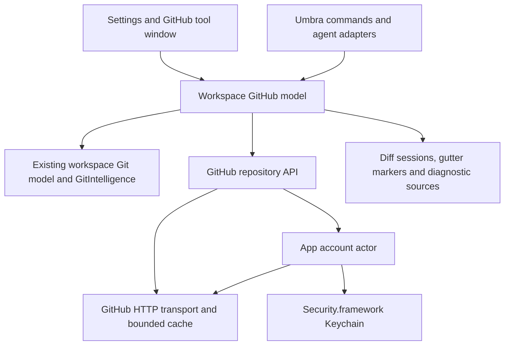

# Native GitHub integration plan

## Architecture and proposed files

Keep files in the Umbra target under `GitHub/`. Start with `GitHubTransport.swift`, `GitHubDeviceAuthorization.swift`, `GitHubCredentialStore.swift`, `GitHubAccounts.swift`, `GitHubRemote.swift`, `GitHubRepositoryClient.swift`, and `IDEGitHubWorkspaceModel.swift`. Add `IDEGitHubSettingsView.swift` and `IDEGitHubToolWindow.swift` as the first native surfaces. Subsequent features can add clients and models in feature subfolders. Use `UmbraTests/GitHub/` and the existing UI test infrastructure. Add narrow integration points in workspace, settings, and commands. Organize provider-neutral identities around host, repository, account, and capabilities as consumers need them. Introduce a provider interface when a second provider has a real consumer and contract.

## Authentication and release configuration

Register an Umbra-owned GitHub App for personal and organization installations. Enable device flow and expiring user access tokens. Publish the app when organization use is ready. Start with Metadata read and add only the permissions in [the endpoint matrix](API_ENDPOINTS.md) as corresponding features ship. Distribution supplies only the public Client ID and an approved installation slug. A missing registration yields a disabled sign-in action with an explanation. No distributed private key, client secret, webhook receiver, or hosted token broker is required for device flow. GitHub user authorization and installation are separate. Show install or request-access guidance independently of account status. Existing installs may require approval when permissions expand. [GitHub App registration](https://docs.github.com/en/apps/creating-github-apps/registering-a-github-app/registering-a-github-app) · [Choosing permissions](https://docs.github.com/en/apps/creating-github-apps/registering-a-github-app/choosing-permissions-for-a-github-app)

A native Settings sheet shows the device code and opens the fixed GitHub verification page in the system browser on user action. Show expiry, cancellation, retry, and the confirmed login from `GET /user`. Users choose the active account explicitly when a remote is ambiguous. Sign-out clears local credentials and data and can link to GitHub's authorized-apps settings for server-side revocation. Reauthorization must validate the numeric user identity before updating an account.

## Ownership, cache, and recovery

- The app account actor owns account identifiers and coordinates one refresh per host, client ID, and numeric user ID. Store the access/refresh pair and expirations as one versioned Keychain item. Await persistence before publishing a rotated pair. Account removal invalidates the account generation, cancels owned work, and prevents late refreshes from restoring the item.
- Each workspace owns its selection, tasks, and generations on the main actor. Cancel on root replacement, switch, and teardown, and reject stale results before publication. Closing one workspace detaches its interest from shared requests. Cancel a coalesced request after its last subscriber leaves. App-owned authentication and refresh remain owned by their initiating flow or the account actor.
- Use typed Sendable requests and values. Perform networking, response decoding, credential I/O, and bounded cache operations outside the main actor. Keep view updates scoped to the feature model.
- Cache selected GET representations in bounded memory. Key by host, account and authorization generation, version, media type, and canonical endpoint with query. Use ETag first and conditional last-modified when appropriate. A 304 must have a matching live entry. Invalidate dependent lists and details after a confirmed mutation. Root and remote changes discard associations. Sign-out, denial, permission changes, and account changes invalidate private entries. Signals for permission changes include authentication failures and installation access mismatches.
- Classify cancellation, offline, expired session, installation required, insufficient permission, hidden or missing resource, rate limit, conflict, invalid input, and server failure. Display context-specific recovery. Treat private 404s as ambiguous. Enforce rate-limit holds across same-account requests. Retry safe reads within a budget. On unknown mutation outcomes, reconcile using a read and present the result before any deliberate retry.

## Native interaction flows and phase gates

Use IntelliJ IDEA's filtered incoming-review list and optional worktree checkout, GitHub Desktop's account-first clone picker, and VS Code's changed-file review navigation as functional references. The Umbra tool window keeps a native list with stable keyboard selection, opens overview or comparison tabs using existing tab chrome, and returns focus to the initiating location after sheets close. [IntelliJ IDEA review](https://www.jetbrains.com/help/idea/work-with-github-pull-requests.html) · [GitHub Desktop clone](https://docs.github.com/en/desktop/adding-and-cloning-repositories/cloning-and-forking-repositories-from-github-desktop) · [VS Code GitHub workflows](https://code.visualstudio.com/docs/sourcecontrol/github)

Every phase requires the gates in [test strategy](TEST_STRATEGY.md) and [performance budget](PERFORMANCE_BUDGET.md). Commands and menus share workspace availability and action handlers. Use Umbra chrome and semantic tokens, stable selection and focus, accessible progress and error labels, keyboard operation, and native confirmation sheets.

| Phase | Scope and dependency | Acceptance |
| --- | --- | --- |
| 0–1 | Audit and plan | Seven docs trace existing reuse points, GitHub capabilities, test strategy, and unresolved dependencies. |
| 2a | Authentication and HTTPS client | Start, cancel, expire, slow down, and complete device flow deterministically. Persist and restore two distinct accounts, single-flight token refresh, and sign-out under cancellation and race tests. Build signed app and verify Keychain behavior. |
| 2b | Discovery and read-only metadata, after 2a | Open a folder and recognize strict GitHub fetch remotes without network on typing. Choose upstream/remote and account when ambiguous. Show repository identity, default branch, visibility and installation access with progressive loading and retry. Test root swap and close. |
| 3 | Browse, clone and publish, after 2b | Browse paginated installation repos and selected-ref tree. Existing clone sheet opens the cloned folder. Publish previews owner, name, visibility and exact ref using existing commits. Reconcile partial creation, local remote configuration, and push. Handle empty repositories with clear state. Independently verify app publication permissions and org-install behavior. |
| 4 | Pull requests, after 3 | Search/filter lists and inspect details, checks, files and comments. Create/edit draft and ready PRs, request reviewers, close/reopen, update branch and merge under target/head checks. Support fork-aware checkout and opt-in linked worktrees. Show ruleset failures and support auto-merge and merge-queue controls when the viewer and repository permit them. |
| 5 | Inline review, after 4 | Reuse split/unified compare and gutter overlays. Bind anchors to repo, PR, diff base/head, old/new path, side, and line range. Render outdated threads separately. Show unsupported or truncated files explicitly. Test local draft recovery, batch submit, reply, resolve and unresolve. |
| 6 | Issues, after 2b | Query, triage, open/edit/close/reopen, comment, and manage labels/assignees; keep PRs out of the Issues list. Restore editor focus after opening linked context. |
| 7 | Actions, after 2b | Runs, jobs, on-demand logs and checks with pause/resume, dispatch, cancel, and rerun. Use existing diagnostic navigation for revision-matched annotations. Show run, ref, and inputs in the confirmation. Keep production environment approval controls in GitHub until separately designed and verified. |
| 8 | Releases and notifications, after 2b | Releases browse, draft, edit, publish and asset handling via explicit actions. Native inbox depends on choosing a supported separate notification credential, with matching-account verification, explicit independent consent, and no fallback to a broader repository credential. |
| 9 | Agent integration, after corresponding workflows | Initial native workflows summarize PRs and CI, triage issues, and draft review or release text. Preview bounded payloads and sending destinations. Mutation tools use the same action validation and explicit human authorization as the UI. ACP work requires verified opt-in host support and credential isolation. |

PR file navigation starts from the complete changed-file inventory where available and uses immutable revision blobs on demand. Prefer local Git blobs when exact merge-base and head objects are present. Pin the merge base through verified compare data or local Git, preserving original and current path for renames. Use existing Git fetch facilities only on user request. Provider patches give anchor context and can be absent, truncated, or differ from the renderer's layout. Bind UI anchors only when the mapping is verified. When head changes, retain the draft with its original revision and ask the user to re-anchor before submission.

## Risks and mitigations

| Risk | Mitigation and release dependency |
| --- | --- |
| Multi-account confusion or installation mismatch | Show verified login and selected repo at action point. Never silently fall through to another account, token family, or anonymous request. |
| Broad Administration / Contents / Actions write permissions | Request at the corresponding phase and verify installation scope. Runtime intent authorization is additional to GitHub permission checks. |
| Broken build or deployment signature | Verify both SwiftPM and signed app, and macOS distribution Keychain access. Test a clean account with each distribution configuration. |
| Truncation and stale refs | Bound pagination, show incomplete state, keep review anchors pinned, and reread remote object identity before sending a write. |
| Wrong provider or endpoint | Exact HTTPS authorities and reviewed operation routes. Keep enterprise hosts and alternate Git providers behind independently verified configuration. |
| Silent partial success | Reconcile on timeout or cancellation after dispatch. Preserve recoverable local state and show the completed step. |

[API and permissions](API_ENDPOINTS.md) · [Security model](SECURITY_MODEL.md) · [Test strategy](TEST_STRATEGY.md) · [Performance budget](PERFORMANCE_BUDGET.md) · [Progress](PROGRESS.md)
