# Mermaid 12.1.0 — All Diagram Types with Examples

Every diagram keyword below was verified against the published `mermaid@12.1.0`
npm tarball (detector regexes in `dist/mermaid.esm.mjs` + sourcemap
`Detector` sources) and the `docs/syntax` pages at git ref `mermaid@12.1.0`.
Examples are minimal renderable snippets taken from those docs pages.

> `ZenUML` has a docs page in 12.1.0 but **no bundled detector** — it is an
> external plugin, so it is noted at the end rather than listed as built-in.
> The `error` diagram is the render-failure fallback, not a user-authored type.
> `flowchart-elk` selects the ELK layout for the flowchart renderer.

## Contents

- [1. Flowchart (`flowchart` / `graph`)](#1-flowchart-flowchart--graph)
- [2. Flowchart with ELK (`flowchart-elk`)](#2-flowchart-with-elk-flowchart-elk)
- [3. Sequence diagram (`sequenceDiagram`)](#3-sequence-diagram-sequencediagram)
- [4. Class diagram (`classDiagram`)](#4-class-diagram-classdiagram)
- [5. State diagram (`stateDiagram-v2`)](#5-state-diagram-statediagram-v2)
- [6. Entity relationship diagram (`erDiagram`)](#6-entity-relationship-diagram-erdiagram)
- [7. Gantt chart (`gantt`)](#7-gantt-chart-gantt)
- [8. Pie chart (`pie`)](#8-pie-chart-pie)
- [9. User journey (`journey`)](#9-user-journey-journey)
- [10. Git graph (`gitGraph`)](#10-git-graph-gitgraph)
- [11. Mindmap (`mindmap`)](#11-mindmap-mindmap)
- [12. Timeline (`timeline`)](#12-timeline-timeline)
- [13. Quadrant chart (`quadrantChart`)](#13-quadrant-chart-quadrantchart)
- [14. Requirement diagram (`requirementDiagram`)](#14-requirement-diagram-requirementdiagram)
- [15. C4 diagrams (`C4Context` …)](#15-c4-diagrams-c4context-)
- [16. Sankey (`sankey`)](#16-sankey-sankey)
- [17. XY chart (`xychart`)](#17-xy-chart-xychart)
- [18. Block diagram (`block`)](#18-block-diagram-block)
- [19. Packet diagram (`packet`)](#19-packet-diagram-packet)
- [20. Kanban (`kanban`)](#20-kanban-kanban)
- [21. Architecture (`architecture-beta`)](#21-architecture-architecture-beta)
- [22. Radar (`radar-beta`)](#22-radar-radar-beta)
- [23. Treemap (`treemap-beta`)](#23-treemap-treemap-beta)
- [24. Info (`info`)](#24-info-info)
- [25. Use case (`usecase-beta`)](#25-use-case-usecase-beta)
- [26. Cynefin (`cynefin-beta`)](#26-cynefin-cynefin-beta)
- [27. Venn (`venn-beta`)](#27-venn-venn-beta)
- [28. Ishikawa / fishbone (`ishikawa-beta`)](#28-ishikawa--fishbone-ishikawa-beta)
- [29. Wardley map (`wardley-beta`)](#29-wardley-map-wardley-beta)
- [30. Tree view (`treeView-beta`)](#30-tree-view-treeview-beta)
- [31. Event modeling (`eventmodeling`)](#31-event-modeling-eventmodeling)
- [32. Agent flow (`agentflow-beta`)](#32-agent-flow-agentflow-beta)
- [33. Swimlanes (`swimlane-beta`)](#33-swimlanes-swimlane-beta)
- [34. Railroad diagrams (`railroad-beta` family)](#34-railroad-diagrams-railroad-beta-family)
- [35. ZenUML (docs only, not bundled)](#35-zenuml-docs-only-not-bundled)

## 1. Flowchart (`flowchart` / `graph`)

Detector: `^\s*(graph|flowchart)`.

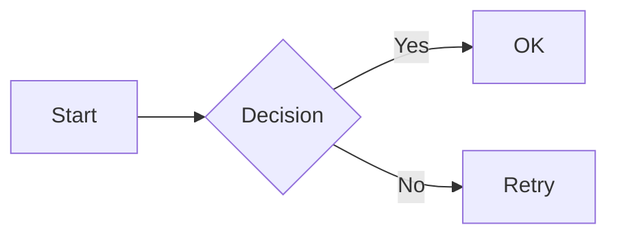

## 2. Flowchart with ELK (`flowchart-elk`)

Detector: `^\s*flowchart-elk` (sets `layout: elk`).

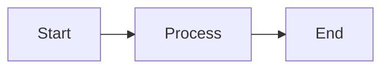

## 3. Sequence diagram (`sequenceDiagram`)

Detector: `^\s*sequenceDiagram`.

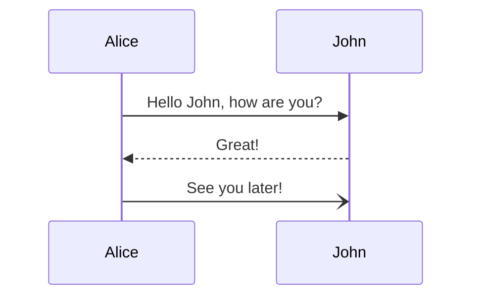

## 4. Class diagram (`classDiagram`)

Detector: `^\s*classDiagram` (also matches `classDiagram-v2`).

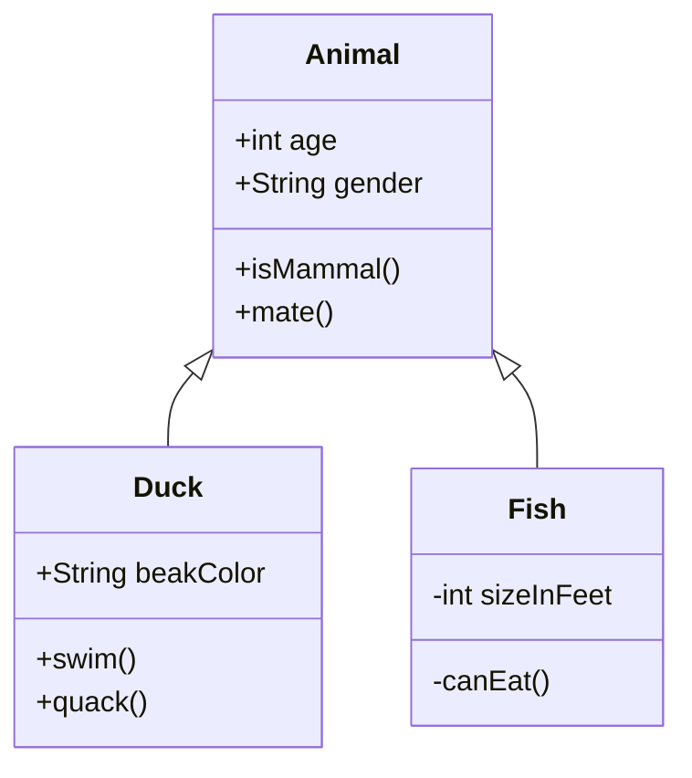

## 5. State diagram (`stateDiagram-v2`)

Detector: `^\s*stateDiagram` (covers `stateDiagram` and `stateDiagram-v2`).

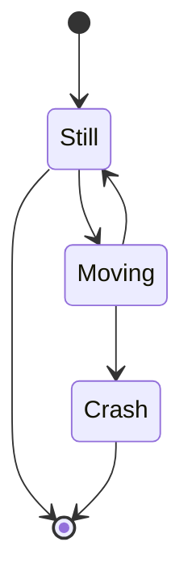

## 6. Entity relationship diagram (`erDiagram`)

Detector: `^\s*erDiagram`.

```mermaid
erDiagram
erDiagram
    CUSTOMER ||--o{ ORDER : places
    ORDER ||--|{ ORDER_ITEM : contains
    PRODUCT ||--o{ ORDER_ITEM : includes
    CUSTOMER {
        string id
        string name
        string email
    }
    ORDER {
        string id
        date orderDate
        string status
    }
    PRODUCT {
        string id
        string name
        float price
    }
    ORDER_ITEM {
        int quantity
        float price
    }
```

## 7. Gantt chart (`gantt`)

Detector: `^\s*gantt`.

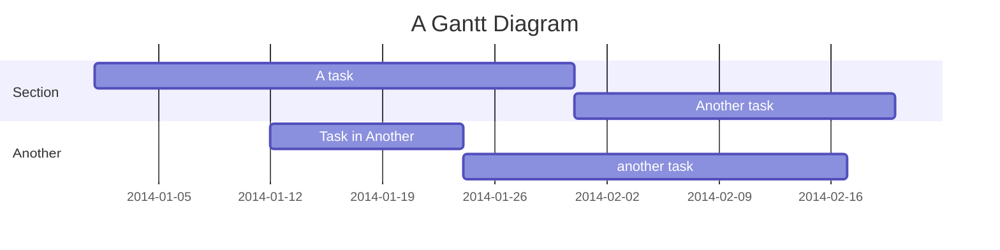

## 8. Pie chart (`pie`)

Detector: `^\s*pie`.

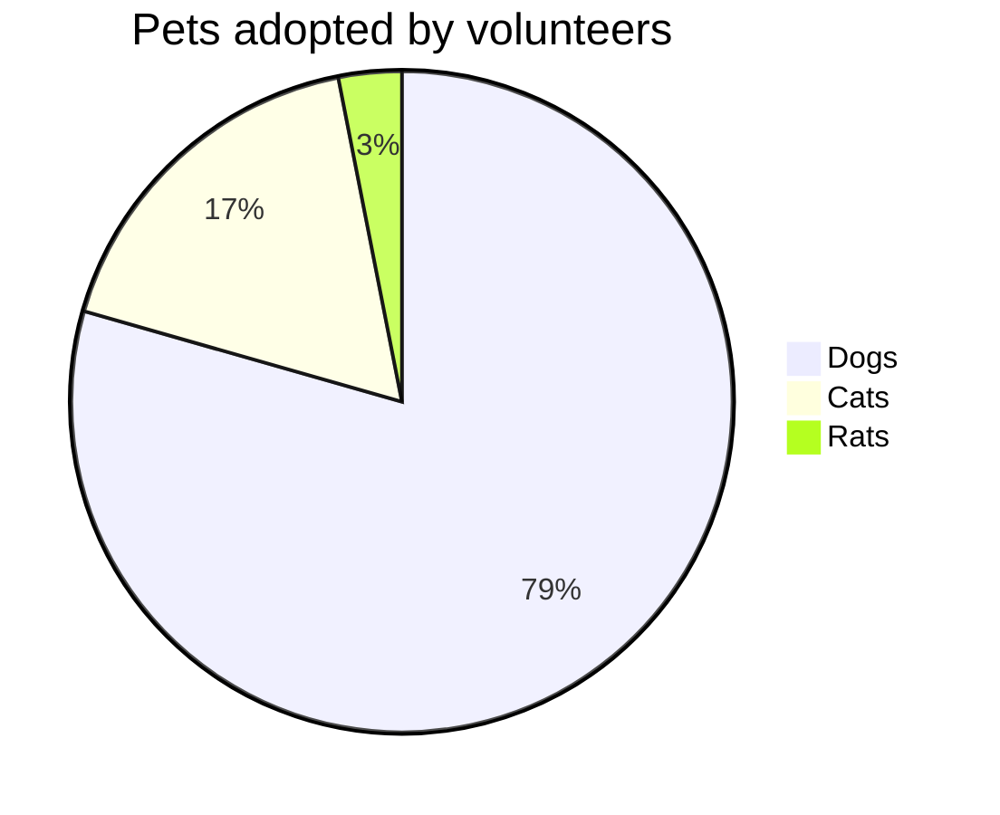

## 9. User journey (`journey`)

Detector: `^\s*journey`.

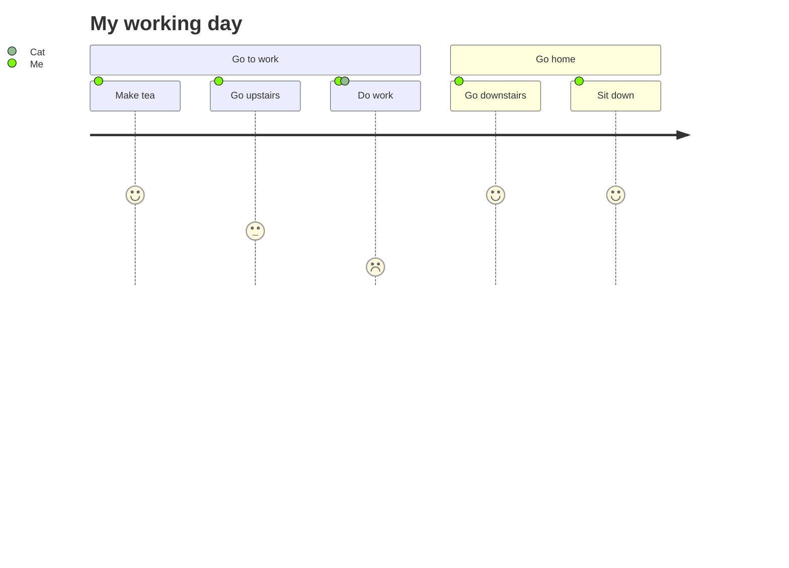

## 10. Git graph (`gitGraph`)

Detector: `^\s*gitGraph`.

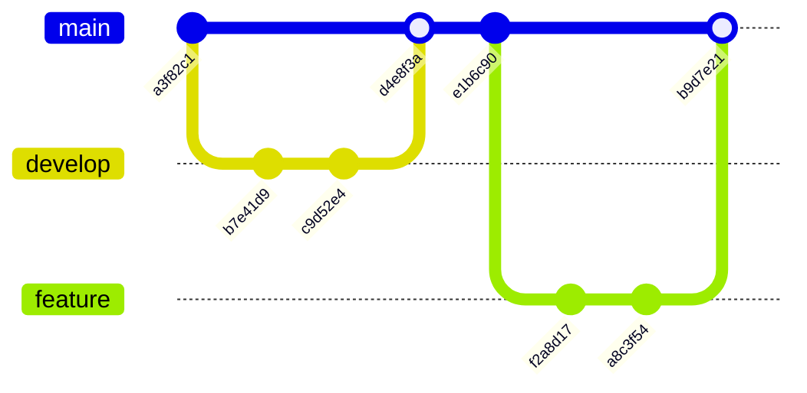

## 11. Mindmap (`mindmap`)

Detector: `^\s*mindmap`.

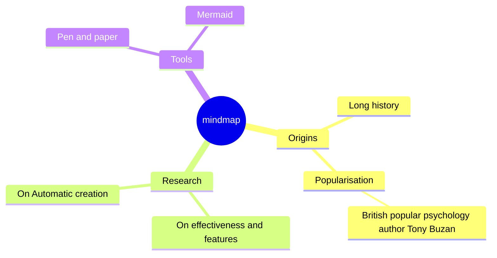

## 12. Timeline (`timeline`)

Detector: `^\s*timeline`.

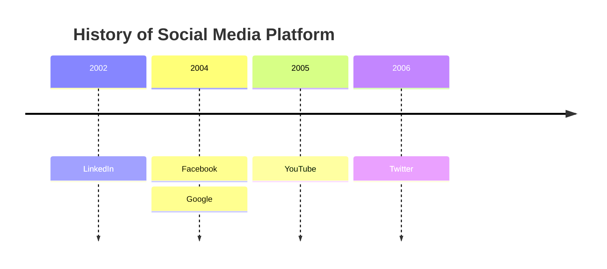

## 13. Quadrant chart (`quadrantChart`)

Detector: `^\s*quadrantChart`.

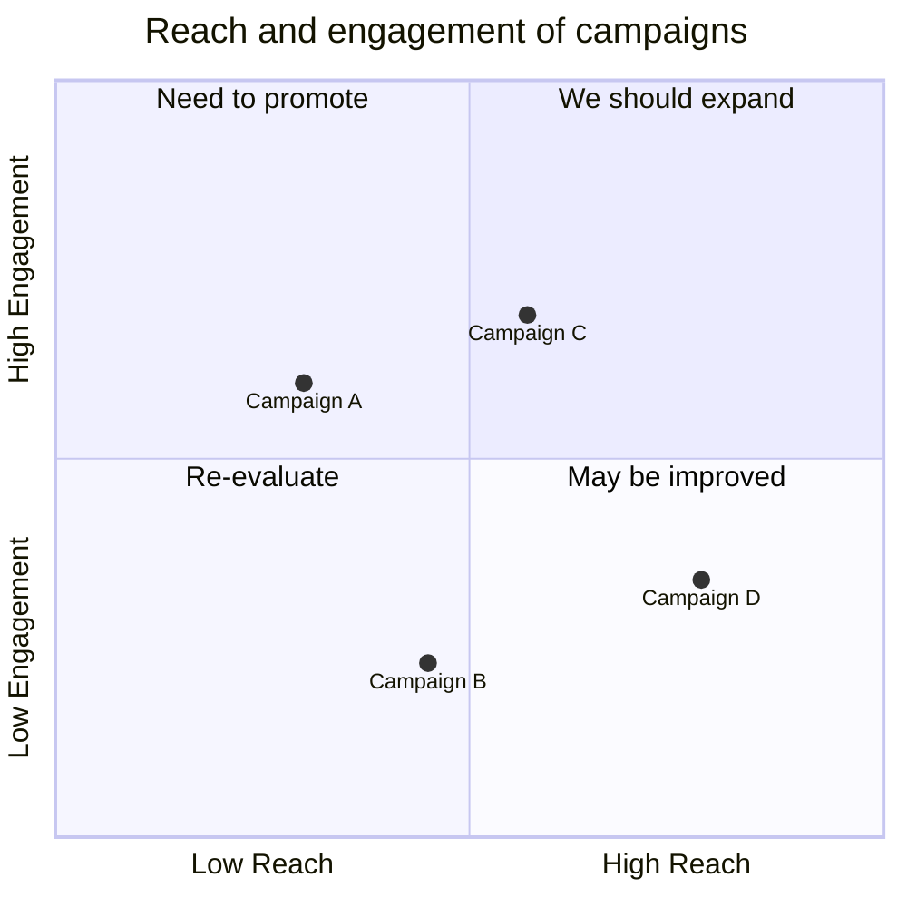

## 14. Requirement diagram (`requirementDiagram`)

Detector: `^\s*requirement(Diagram)?`.

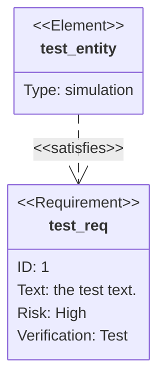

## 15. C4 diagrams (`C4Context` …)

Detector: `^\s*C4Context|C4Container|C4Component|C4Dynamic|C4Deployment`.

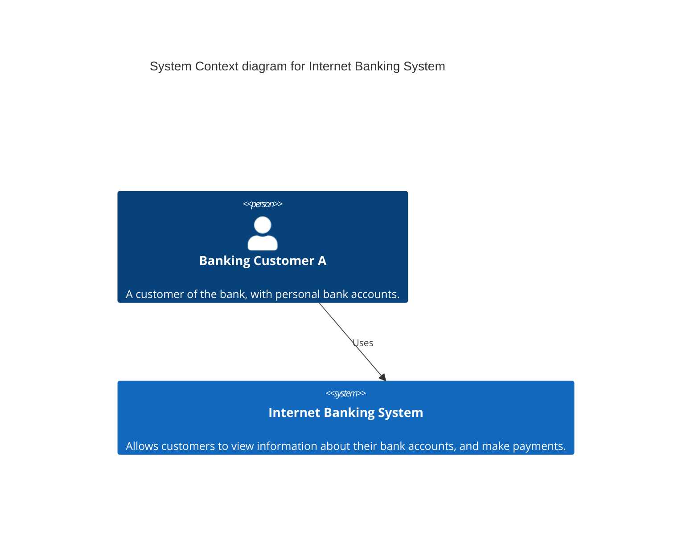

## 16. Sankey (`sankey`)

Detector: `^\s*sankey(-beta)?`.

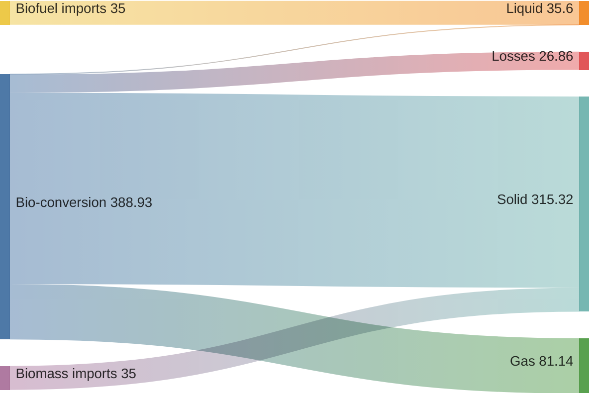

## 17. XY chart (`xychart`)

Detector: `^\s*xychart(-beta)?`.

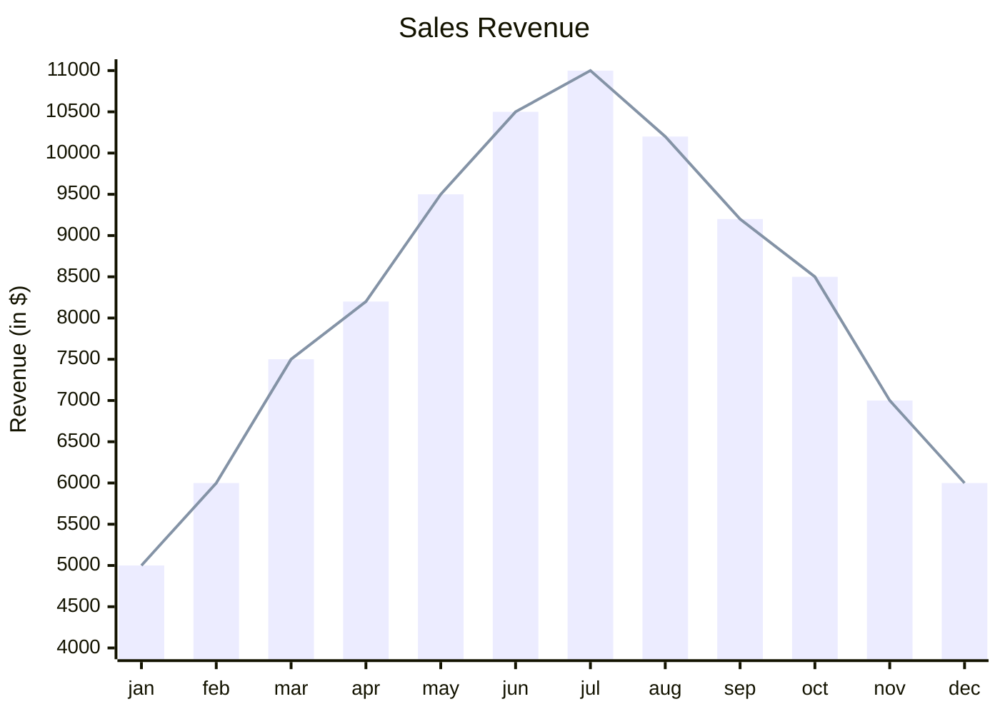

## 18. Block diagram (`block`)

Detector: `^\s*block(-beta)?`.

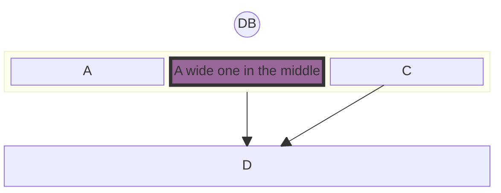

## 19. Packet diagram (`packet`)

Detector: `^\s*packet(-beta)?`.

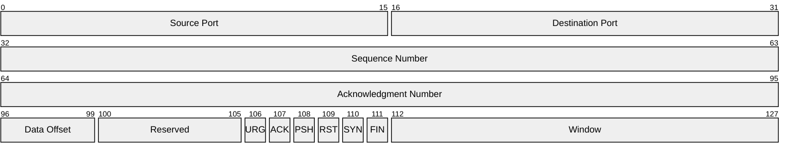

## 20. Kanban (`kanban`)

Detector: `^\s*kanban`.

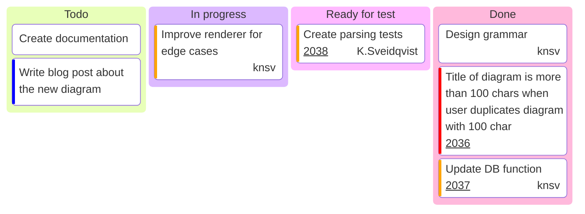

## 21. Architecture (`architecture-beta`)

Detector: `^\s*architecture`.

```mermaid
architecture-beta
    group api(cloud)[API]

    service db(database)[Database] in api
    service disk1(disk)[Storage] in api
    service disk2(disk)[Storage] in api
    service server(server)[Server] in api

    db:L -- R:server
    disk1:T -- B:server
    disk2:T -- B:db
```

## 22. Radar (`radar-beta`)

Detector: `^\s*radar-beta`.

```mermaid
radar-beta
  axis m["Math"], s["Science"], e["English"]
  axis h["History"], g["Geography"], a["Art"]
  curve a["Alice"]{85, 90, 80, 70, 75, 90}
  curve b["Bob"]{70, 75, 85, 80, 90, 85}

  max 100
  min 0
```

## 23. Treemap (`treemap-beta`)

Detector: `^\s*treemap`.

```mermaid
treemap-beta
"Category A"
    "Item A1": 10
    "Item A2": 20
"Category B"
    "Item B1": 15
    "Item B2": 25
```

## 24. Info (`info`)

Detector: `^\s*info`.

```mermaid
info
```

## 25. Use case (`usecase-beta`)

Detector: `^\s*usecase-beta(?:\s|$)`.

```mermaid
usecase-beta
direction LR
actor Customer("Customer")
systemBoundary "Order system"
  Checkout("Place order")
end
Customer --> Checkout
```

## 26. Cynefin (`cynefin-beta`)

Detector: `^\s*cynefin-beta(?:[\s:]|$)`.

```mermaid
cynefin-beta
  title Incident Response

  complex
    "Investigate root cause"
    "Run chaos experiment"

  complicated
    "Analyze performance data"
    "Expert review needed"

  clear
    "Restart service"
    "Apply known fix"

  chaotic
    "Page on-call immediately"

  confusion
    "Unknown failure mode"
```

## 27. Venn (`venn-beta`)

Detector: `^\s*venn-beta`.

```mermaid
venn-beta
  title What makes a good feature
  set Desirable
  set Feasible
  set Viable
  union Desirable,Feasible["Buildable"]
  union Feasible,Viable["Sustainable"]
  union Desirable,Viable["Marketable"]
  union Desirable,Feasible,Viable["Ship it"]
```

## 28. Ishikawa / fishbone (`ishikawa-beta`)

Detector: `^\s*ishikawa(-beta)?\b` (case-insensitive).

```mermaid
ishikawa-beta
    Blurry Photo
    Process
        Out of focus
        Shutter speed too slow
        Protective film not removed
    User
        Shaky hands
    Equipment
        LENS
            Inappropriate lens
            Damaged lens
            Dirty lens
    Environment
        Subject moved too quickly
        Too dark
```

## 29. Wardley map (`wardley-beta`)

Detector: `^\s*wardley-beta` (case-insensitive).

```mermaid
wardley-beta
title Tea Shop Value Chain

anchor Business [0.95, 0.63]
component Cup of Tea [0.79, 0.61]
component Tea [0.63, 0.81]
component Hot Water [0.52, 0.80]
component Kettle [0.43, 0.35]
component Power [0.10, 0.70]

Business -> Cup of Tea
Cup of Tea -> Tea
Cup of Tea -> Hot Water
Hot Water -> Kettle
Kettle -> Power

evolve Kettle 0.62
evolve Power 0.89
```

## 30. Tree view (`treeView-beta`)

Detector: `^\s*treeView-beta`.

```mermaid
treeView-beta
├── src/
│   ├── index.ts
│   └── utils.ts
├── package.json
└── README.md
```

## 31. Event modeling (`eventmodeling`)

Detector: `^\s*eventmodeling`.

```mermaid
eventmodeling
timeframe 01 ui CartUI
timeframe 02 command AddItem { description: string }
timeframe 03 event ItemAdded { description: string }
```

## 32. Agent flow (`agentflow-beta`)

Detector: `^\s*agentflow-beta\b`.

```mermaid
agentflow-beta TB
  flow reviewer["Review Agent"]
    changes["Gather changes"]@{ shape: input }
    analyse["Analyse diff"]@{ shape: task }
    lint["run_linter"]@{ shape: tool }
    ok["Clean?"]@{ shape: decision }

    changes --> analyse --> lint --> ok
  end
```

## 33. Swimlanes (`swimlane-beta`)

Detector: `^\s*swimlane-beta\b`.

```mermaid
swimlane-beta LR
  subgraph Customer
    Browse[Browse catalogue]
    Pay[Pay]
  end
  subgraph Warehouse
    Pick[Pick items]
    Ship[Ship order]
  end
  subgraph Finance
    Invoice[Raise invoice]
  end
  Browse --> Pay
  Pay --> Pick
  Pick --> Ship
  Pay --> Invoice
```

## 34. Railroad diagrams (`railroad-beta` family)

Detectors: `railroad-beta`, `railroad-abnf-beta`, `railroad-ebnf-beta`,
`railroad-peg-beta` (all case-insensitive).

```mermaid
railroad-ebnf-beta
    title Expression Grammar

    expression = term ( "+" term | "-" term )* ;
    term = factor ( "*" factor | "/" factor )* ;
    factor = number | "(" expression ")" ;
    number = digit+ ;
    digit = "0" | "1" | "2" | "3" | "4" | "5" | "6" | "7" | "8" | "9" ;

digit = "0" | "1" | "2" | "3" | "4" | "5" | "6" | "7" | "8" | "9" ;
```

ABNF / PEG variants use the same shape with their own keyword:

```mermaid
railroad-abnf-beta
    title Email Address

    address = local-part "@" domain ;
    local-part = 1*( ALPHA / DIGIT / "." / "-" ) ;
    domain = label *( "." label ) ;
    label = 1*( ALPHA / DIGIT / "-" ) ;
```

```mermaid
railroad-peg-beta
    title Calculator Grammar

    Expression <- Term (("+" / "-") Term)* ;
    Term <- Factor (("*" / "/") Factor)* ;
    Factor <- Number / "(" Expression ")" ;
    Number <- Digit+ ;
    Digit <- "0" / "1" / "2" / "3" / "4" / "5" / "6" / "7" / "8" / "9" ;
```

## 35. ZenUML (docs only, not bundled)

`docs/syntax/zenuml.md` exists at `mermaid@12.1.0`, but the published package
registers no `zenuml` detector — it renders via the external ZenUML plugin,
so it is not a built-in 12.1.0 diagram type. Documented syntax for reference:

```mermaid
zenuml
    title Demo
    Alice->John: Hello John, how are you?
    John->Alice: Great!
    Alice->John: See you later!
```

## Sources

- `mermaid@12.1.0` npm tarball detector sources
  (`dist/mermaid.esm.mjs` + `.map`, `../src/diagrams/*/…Detector.ts`).
- `docs/syntax/*.md` at git ref `mermaid@12.1.0` (35 pages, incl. `zenuml.md`).
```
